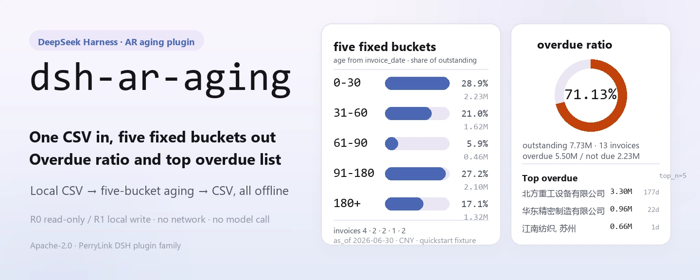
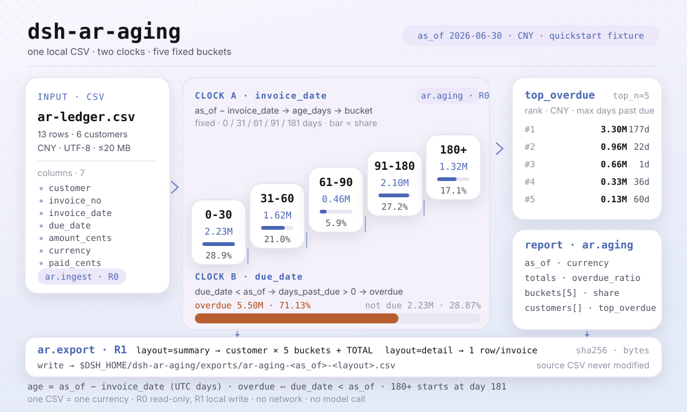
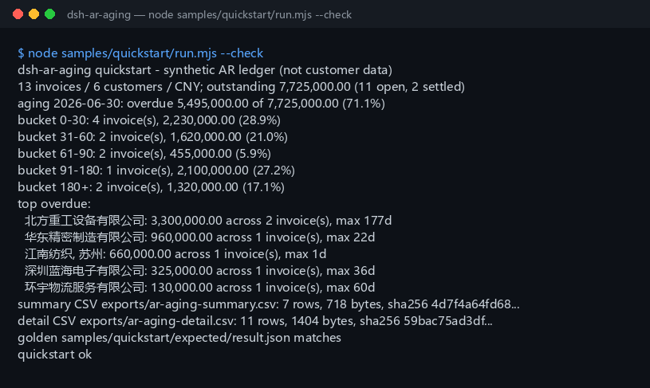

<div align="center">

<picture>
  <source media="(prefers-color-scheme: dark)" srcset="docs/assets/dsh-ar-aging-hero-en-dark.webp">
  
</picture>

# dsh-ar-aging

**Turn an AR ledger CSV into an aging report: buckets, customer summary, overdue ratio and top overdue customers, then export CSV.**

A local-only AR aging tool for DeepSeek Harness: three tools read one local CSV, age invoices from the invoice date, measure overdue from the due date — no network, no model call, no upload.

[Install](#three-step-setup) · [Configuration](#configuration) · [FAQ](#faq) · [简体中文](README.md) · [English](README.en.md) · [Español](README.es.md) · [Português](README.pt.md) · [हिन्दी](README.hi.md)

[](LICENSE)
[](#compatibility)
[](https://www.npmjs.com/package/dsh-ar-aging)
[](https://github.com/PerryLink/dsh-ar-aging/actions/workflows/ci.yml)
[](#compatibility)

[](https://github.com/PerryLink/dsh-ar-aging/stargazers)
[](https://www.npmjs.com/package/dsh-ar-aging)
[](https://dshfind.com/plugins/PerryLink/dsh-ar-aging?ref=badge)
[](https://gitee.com/perrylink/dsh-ar-aging)

```sh
dsh plugin --profile <profile> add dsh-ar-aging
```

</div>

<sub>Community plugin, not affiliated with DeepSeek. Canonical repository: <https://github.com/PerryLink/dsh-ar-aging> (Gitee is a mirror).</sub>

<sub>Status: alpha / public-synthetic / partial / not counted / not GA — no customer data, no customer evidence, no production-readiness or audit-conclusion claim.</sub>

## One-liner

Read a local AR ledger CSV, age open invoices from their invoice date (`as_of - invoice_date`), measure overdue from their due date (`due_date < as_of`), and write a fixed five-bucket aging table plus a customer summary, an overdue ratio and a top-overdue list — then export the result as CSV.

- **Fits:** 10s to 1000s of rows exported from an ERP or accounting system; a 0-30 / 31-60 / 61-90 / 91-180 / 180+ aging table; an overdue ratio and a top-overdue list for a collections review; a CSV to hand to finance or archive.
- **Does not fit:** converting multiple currencies into one (no FX here); write-offs, bad-debt provisioning, impairment or collection advice; PDF, scans or Excel as direct input (export CSV first); replacing an auditor, tax adviser or credit decision; credit notes / negative invoices.

<picture>
  <source media="(prefers-color-scheme: dark)" srcset="docs/assets/dsh-ar-aging-flow-v5-dark.svg">
  
</picture>

## Three-step setup

1. **Install** (pick one channel):

   ```sh
   # npm channel (recommended; published releases)
   dsh plugin --profile <profile> add dsh-ar-aging
   # git channel (latest main; equivalent to git+https://github.com/PerryLink/dsh-ar-aging.git)
   dsh plugin --profile <profile> add github:PerryLink/dsh-ar-aging
   # tarball channel: pnpm pack in this repo, then
   dsh plugin --profile <profile> add ./dsh-ar-aging-<version>.tgz
   ```

2. **Minimal config** (no Config keys at all; `cordis.patch.yml` only inserts this row):

   ```yaml
   - insert:
       - id: dsh-ar-aging
         name: dsh-ar-aging
   ```

3. **Verify it mounts**:

   ```sh
   dsh --profile <profile> --dump-config | grep dsh-ar-aging
   node samples/quickstart/run.mjs --check
   ```

**Uninstall**: `dsh plugin --profile <profile> remove dsh-ar-aging` (or remove the row from the profile patch).

## Core capabilities

Tool names are stable API; tool descriptions stay in English to match runtime output.

| Tool | Purpose | Risk |
|---|---|---|
| `ar.ingest` | Validate and normalize the AR CSV; return totals, settled/open counts and a 5-row preview | R0 |
| `ar.aging` | Build the five aging buckets, customer summary, overdue ratio and top overdue customers at `as_of` | R0 |
| `ar.export` | Write the customer aging table (`summary`) or invoice-level trace (`detail`) as CSV, returning path + sha256 | R1 local write |

- **Fixed five buckets** — `0-30` / `31-60` / `61-90` / `91-180` / `180+`; age counts from the invoice date, overdue from the due date, and the two measures never mix.
- **Customer summary and top overdue** — customers sort by outstanding descending; top overdue sorts by overdue amount, then longest overdue days; `top_n` accepts 1–50 (default 5).
- **Two export layouts** — `layout=summary` is customer × bucket plus a `TOTAL` row, `layout=detail` is one row per open invoice; every export returns a `sha256` checksum.
- **Local only, zero runtime dependencies** — no network, no model call, no upload; the source CSV is read-only and never modified.
- **Errors carry a next action** — every error pairs one sentence with a stable `E_AR_*` code and a next action; the exact format is shown under "Error codes".

## Input

- UTF-8 CSV with a header row and comma separators. Quoted commas, embedded newlines and doubled quotes (RFC 4180) are supported, as are CRLF and a UTF-8 BOM.
- Header row; extra columns are ignored. Chinese aliases work too:

```text
customer,invoice_no,invoice_date,due_date,amount_cents,currency,paid_cents
客户 / 发票号 / 开票日 / 到期日 / 金额分 / 币种 / 已收金额分
```
- Dates: `YYYY-MM-DD`; `due_date` must not be earlier than `invoice_date`.
- Amounts: integer **cents**; `amount_cents > 0` and `0 <= paid_cents <= amount_cents`.
- Currency: a 3-letter code such as `CNY`. **One CSV must use one currency**; mixing raises `E_AR_CSV_ROW`.
- Invoice numbers must be unique within the file.
- Size: up to 20 MB per file; split by customer or month beyond that.
- Source: the local CSV the user names; it is read-only and never modified.

## Output

- `ar.ingest`: `{ source_sha256, rows, customers, currency, invoice_date_min, invoice_date_max, due_date_min, due_date_max, total_cents, paid_cents, outstanding_cents, settled_rows, open_rows, preview }`. `preview` holds the first five normalized rows.
- `ar.aging`: `{ as_of, currency, totals, buckets, customers, top_overdue }`. `totals` carries outstanding, overdue, not-due and `overdue_ratio`; `buckets` is always the five buckets; `customers` is sorted by outstanding; `top_overdue` defaults to five customers (`top_n` accepts 1–50).
- `ar.export`: writes the aging table under `$DSH_HOME/dsh-ar-aging/exports/` and returns path, `sha256`, bytes and rows. `layout=summary` (default) is customer × bucket plus a `TOTAL` row; `layout=detail` is one row per open invoice. The source CSV is untouched.

### Aging rules

1. Age = `as_of - invoice_date` in whole UTC days. An `as_of` earlier than any invoice date raises `E_AR_DATE_INVALID`.
2. Buckets: `0-30` (0–30), `31-60` (31–60), `61-90` (61–90), `91-180` (91–180), `180+` (181+).
3. Overdue: `due_date < as_of` and outstanding > 0; due today is not overdue.
4. Overdue ratio = overdue outstanding ÷ total outstanding, rounded to 4 decimals (0.7113 = 71.13%).
5. Customers sort by outstanding descending, then name ascending. Top overdue sorts by overdue amount, then longest overdue days.
6. The summary CSV ends with a `TOTAL` row; the detail CSV contains open invoices only, sorted by customer, due date and invoice number.

A fully paid invoice (`paid_cents = amount_cents`) counts in `settled_rows` but is excluded from buckets and detail exports.

## Example

Paste this one line into the agent:

```text
我有这份应收明细，按 2026-06-30 出账龄表：分桶、客户汇总和 Top 逾期客户，再导出 CSV。
```

Reproduce the bundled sample and compare with the golden file:

```sh
node samples/quickstart/run.mjs --check
```



The sample is a 13-row synthetic ledger with 6 customers in one currency (CNY). It covers all five buckets, one partial payment, two settled invoices and a customer name with a comma, quoted per RFC 4180 (verbatim from `samples/quickstart/input/ar-ledger.csv`):

```text
"江南纺织, 苏州",INV-2026-0031,2026-01-18,2026-02-17,88000000,CNY,88000000
```

`samples/quickstart/expected/result.json` is the real stdout of `node samples/quickstart/run.mjs --json`, not hand-written. The screenshot above is the genuine output of that command (raw log kept at [`docs/assets/quickstart.log`](docs/assets/quickstart.log)).

## Configuration

This plugin has **no Config keys** — everything is tunable through the three tools' call parameters:

| Tool | Parameter | Required | Meaning |
|---|---|---|---|
| `ar.ingest` | `path` | yes | Absolute path of the AR ledger CSV |
| `ar.aging` | `path`, `as_of` | yes | `as_of` is the aging reference date (`YYYY-MM-DD`); pass it explicitly for a reproducible "today" |
| `ar.aging` | `top_n` | no | Number of top overdue customers, 1–50, default 5 |
| `ar.export` | `path`, `as_of` | yes | Same as above |
| `ar.export` | `layout` | no | `summary` (default) or `detail` |
| `ar.export` | `filename` | no | Export filename, `[A-Za-z0-9._-]` only; defaults to `ar-aging-<as_of>-<layout>.csv` |

Call examples (tool surface):

```sh
# 1) validate and see totals
#    tool surface: ar.ingest({ path: "/abs/path/ar-ledger.csv" })

# 2) build the aging report
#    tool surface: ar.aging({ path: "/abs/path/ar-ledger.csv", as_of: "2026-06-30", top_n: 5 })

# 3) export CSV
#    tool surface: ar.export({ path: "/abs/path/ar-ledger.csv", as_of: "2026-06-30", layout: "summary" })
```

Tests can override the local write root with the `DSH_AR_AGING_HOME` environment variable; the default is exactly `$DSH_HOME/dsh-ar-aging`.

## FAQ

<details>
<summary>Is aging measured from the invoice date or the due date?</summary>

From the **invoice date** (`as_of - invoice_date`). Overdue is measured separately from the **due date** (`due_date < as_of`). An invoice aged 100 days but not yet due lands in `91-180` with zero overdue amount.

</details>

<details>
<summary>What about multiple currencies?</summary>

One CSV must use one currency; mixing raises `E_AR_CSV_ROW`. There is no FX conversion and no cross-currency total here. Split the file by currency, or convert in the source system first.

</details>

<details>
<summary>How are partial payments and settled invoices handled?</summary>

Outstanding = `amount_cents - paid_cents`. Partially paid invoices enter aging at their outstanding balance. A fully paid invoice counts in `settled_rows` but is excluded from buckets, the customer summary and detail exports. `paid_cents > amount_cents` raises `E_AR_AMOUNT`.

</details>

<details>
<summary>Are amounts in yuan or cents?</summary>

The tool API uses integer **cents** everywhere. `128000000` means 1,280,000.00. Exported CSV renders two decimals so a spreadsheet can open it directly.

</details>

<details>
<summary>Does it modify or upload my file?</summary>

No. It reads the named CSV, writes only under `$DSH_HOME/dsh-ar-aging/exports/`, and never uses the network, a model call or an upload.

</details>

## Permissions

Read: the AR ledger CSV the user names (sample: `samples/quickstart/input/ar-ledger.csv`); nothing else.
Write: `$DSH_HOME/dsh-ar-aging/exports/` only; the source CSV is not modified.
Network: no.
External systems: none.

`ar.ingest` and `ar.aging` are **R0** (read-only). `ar.export` is **R1** (local write under `$DSH_HOME/dsh-ar-aging/exports/`). `DSH_AR_AGING_HOME` can override the local write root for tests; the default is exactly `$DSH_HOME/dsh-ar-aging`.

## Error codes

| Code | When | Next action |
|---|---|---|
| `E_AR_CSV_ROW` | Wrong column count, missing header, empty customer/invoice, duplicate invoice, mixed currency, empty or >20 MB file | Fix the named row, split by currency or month |
| `E_AR_DATE_INVALID` | Not `YYYY-MM-DD`, impossible date, due before invoice, `as_of` before an invoice | Use ISO dates and check ordering |
| `E_AR_AMOUNT` | Not a non-negative integer of cents, zero amount, paid above amount | Use integer cents and `0 <= paid <= amount` |
| `E_AR_PATH_INVALID` | Input missing / a directory / unreadable, unwritable exports directory, or an unsafe export filename | Pass an existing CSV; export with `[A-Za-z0-9._-]` only |

The message format is:

```text
<one sentence>（E_AR_XXX）｜下一步：<one action>
```

See [TROUBLESHOOTING.md](TROUBLESHOOTING.md).

## Acceptance evidence

Public/synthetic fixtures live in `samples/quickstart/`; `ACCEPTANCE.csv` records the checks. Every row is `counted=false` except the quickstart row.

| req_id | metric | threshold | actual | pass | source | counted |
|---|---|---|---|---|---|---|
| AR-A01 | ingest totals | rows=13 customers=6 | rows=13 customers=6 | true | public/synthetic | false |
| AR-A02 | aging buckets | counts=4/2/2/1/2 | counts=4/2/2/1/2 | true | public/synthetic | false |
| AR-A03 | overdue ratio | overdue=549500000 ratio=0.7113 | overdue=549500000 ratio=0.7113 | true | public/synthetic | false |
| PS1-QS01 | quickstart golden | 1/1 | 1 | true | synthetic/quickstart | true |

*Fixture-backed rows, not a customer run; no output is invented.*

## Limits and known limitations

- **Single currency:** no FX conversion; split files by currency.
- **No credit notes:** `amount_cents` must be > 0. Offset red invoices in the source system first.
- Aging and overdue statistics only: no write-off, bad-debt provision, impairment, collection strategy or audit opinion.
- CSV only: no PDF, scans or Excel, and no OCR. Export CSV from the source system first.
- Amount precision is one cent; dates use UTC calendar days. Pass `as_of` explicitly for a reproducible "today".
- Exported CSV uses RFC 4180 quoting only; Excel formula prefixes are not sanitised.
- Local only: no network, no model call, no upload.
- Public/synthetic samples only; alpha/partial, not counted, no GA or production-readiness claim.

## Compatibility

| Surface | Status |
|---|---|
| Harness | `dsh >=0.2.1-rc.3 <0.4.0` |
| Node | `>=24.9.0 <25` |
| Platforms | All; local files only |
| Data | No network, no model call, no upload |

## Ecosystem & quality

- [Gitee mirror](https://gitee.com/perrylink/dsh-ar-aging) (sync mirror; GitHub is canonical)
- [dshfind plugin page](https://dshfind.com/plugins/PerryLink/dsh-ar-aging) (installs and ranking)
- **1024 store channel**: `npm i -g dsh1024` once, then `dsh1024 plugin --profile <profile> add dsh-ar-aging` (counts toward the [deepseek1024.com](https://deepseek1024.com) install ranking)
- [Ecosystem knowledge base](https://perrylink.github.io/dsh-plugin-guide/) — plugin development guide · measured selection data · maintenance criteria

## Related work

- [dsh-bankrec](https://github.com/PerryLink/dsh-bankrec) (bank statement reconciliation)
- [dsh-fin-invoice-core](https://github.com/PerryLink/dsh-fin-invoice-core) (invoice core logic)
- [Domain index](https://perrylink.github.io/dsh-plugins/)

## Development

```sh
pnpm install --frozen-lockfile
pnpm build && pnpm lint && pnpm typecheck
node --test test/*.test.mjs
node scripts/gate.mjs
```

Current version `0.1.0`; 53 tests pass (`node --test test/*.test.mjs`). Release gate: `node scripts/gate.mjs` (metadata lint + every public acceptance row passing + all four stable error codes exercised). The banner and the structure diagram are generated programmatically by [`scripts/gen-readme-assets.py`](scripts/gen-readme-assets.py) (Pillow for the four 1440x576 webp banners, hand-written SVG for the light/dark 1100x660 diagram) and are safe to re-run; `docs/assets/quickstart.png` is a real captured screenshot, kept together with `docs/assets/quickstart.log`.

Topics: `dsh`, `dsh-plugin`, `deepseek-harness`, `accounts-receivable`, `ar-aging`, `aging-report`, `finance`, `csv`, `perrylink`

## Family & thanks

This project is part of the DeepSeek Harness plugin family from [PerryLink](https://github.com/PerryLink) (all Apache-2.0). If it is useful, **a star helps the next person find it** — nothing is gated behind it.

- [@PerryLink](https://github.com/PerryLink) — creator and maintainer: the aging engine, the CSV parser and exporter, the three tool surfaces, the quickstart golden sample and the five-language docs.

## License

[LICENSE](LICENSE) (Apache License 2.0) © 2026 dsh-ar-aging contributors. See also `NOTICE` and `THIRD-PARTY-NOTICES`.

<p align="center"><sub>Apache-2.0 · Community plugin, not affiliated with DeepSeek.</sub></p>
