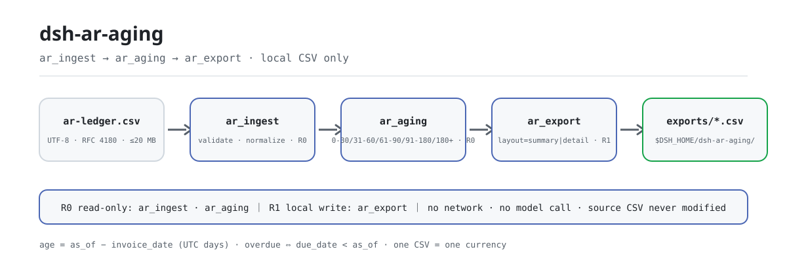
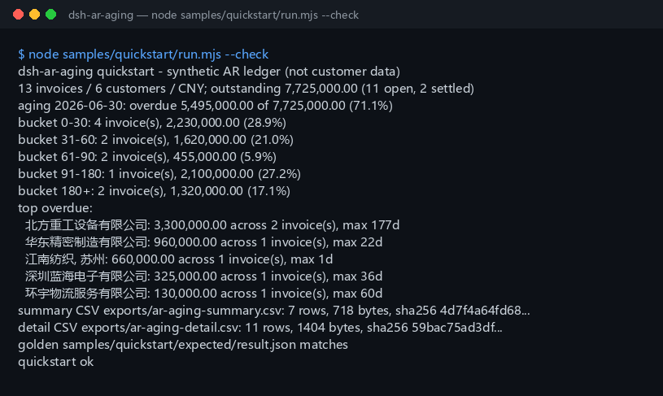

<div align="center">

<picture>
  <source media="(prefers-color-scheme: dark)" srcset="docs/assets/dsh-ar-aging-flow-dark.svg">
  
</picture>

# dsh-ar-aging

**Convierte un libro auxiliar de cuentas por cobrar en CSV en un informe de antigüedad: tramos, resumen por cliente, ratio vencido y principales clientes vencidos, y exporta el resultado a CSV.**

Una herramienta de aging de cuentas por cobrar puramente local para DeepSeek Harness: tres herramientas leen un CSV local, calculan la antigüedad desde la fecha de factura y el vencimiento desde la fecha de vencimiento — sin red, sin llamadas al modelo, sin subidas.

[Instalar](#instalación-en-tres-pasos) · [Configuración](#configuración) · [FAQ](#faq) · [简体中文](README.md) · [English](README.en.md) · [Español](README.es.md) · [Português](README.pt.md) · [हिन्दी](README.hi.md)

[](LICENSE)
[](#compatibilidad)
[](https://www.npmjs.com/package/dsh-ar-aging)
[](https://github.com/PerryLink/dsh-ar-aging/actions/workflows/ci.yml)
[](#compatibilidad)

[](https://github.com/PerryLink/dsh-ar-aging/stargazers)
[](https://www.npmjs.com/package/dsh-ar-aging)
[](https://dshfind.com/plugins/PerryLink/dsh-ar-aging?ref=badge)
[](https://gitee.com/perrylink/dsh-ar-aging)

```sh
dsh plugin --profile <profile> add dsh-ar-aging
```

</div>

<sub>Plugin de la comunidad, no afiliado a DeepSeek. Repositorio canónico: <https://github.com/PerryLink/dsh-ar-aging> (Gitee es un espejo).</sub>

<sub>Estado: alpha / público-sintético / partial / not counted / no GA — sin datos de clientes, sin evidencia de clientes y sin declaración de idoneidad para producción ni de conclusión de auditoría.</sub>

## Qué es

En una frase: lee un CSV local de cuentas por cobrar, calcula la antigüedad desde la fecha de factura (`as_of - invoice_date`) y el vencimiento desde la fecha de vencimiento (`due_date < as_of`), y produce una tabla de cinco tramos fijos, un resumen por cliente, el ratio vencido y la lista de principales clientes vencidos, exportable a CSV.

- **Encaja**: decenas a miles de filas exportadas de un ERP o sistema contable; una tabla de aging 0-30 / 31-60 / 61-90 / 91-180 / 180+; un ratio vencido y una lista de principales vencidos para una revisión de cobros; un CSV para entregar a finanzas o archivar.
- **No encaja**: convertir varias monedas en una (aquí no hay FX); castigos, provisiones por dudosos, deterioro o consejos de cobro; PDF, escaneos o Excel como entrada directa (exporta primero a CSV); sustituir a un auditor, asesor fiscal o decisión de crédito; notas de crédito / facturas negativas.

## Instalación en tres pasos

1. **Instala** (elige un canal):

   ```sh
   # canal npm (recomendado; versiones publicadas)
   dsh plugin --profile <profile> add dsh-ar-aging
   # canal git (último main; equivalente a git+https://github.com/PerryLink/dsh-ar-aging.git)
   dsh plugin --profile <profile> add github:PerryLink/dsh-ar-aging
   # canal tarball: pnpm pack en este repo y luego
   dsh plugin --profile <profile> add ./dsh-ar-aging-<version>.tgz
   ```

2. **Configuración mínima** (no hay ninguna clave de Config; `cordis.patch.yml` solo inserta esta fila):

   ```yaml
   - insert:
       - id: dsh-ar-aging
         name: dsh-ar-aging
   ```

3. **Verifica que se monta**:

   ```sh
   dsh --profile <profile> --dump-config | grep dsh-ar-aging
   node samples/quickstart/run.mjs --check
   ```

**Desinstalar**: `dsh plugin --profile <profile> remove dsh-ar-aging` (o elimina la fila del patch del perfil).

## Capacidades clave

Los nombres de las herramientas son API estable; sus descripciones se mantienen en inglés para coincidir con la salida en tiempo de ejecución.

| Herramienta | Propósito | Riesgo |
|---|---|---|
| `ar.ingest` | Valida y normaliza el CSV de cuentas por cobrar; devuelve totales, conteos de liquidadas/abiertas y una vista previa de 5 filas | R0 |
| `ar.aging` | Construye los cinco tramos de aging, el resumen por cliente, el ratio vencido y los principales clientes vencidos a `as_of` | R0 |
| `ar.export` | Escribe la tabla de aging por cliente (`summary`) o el detalle por factura (`detail`) como CSV, devolviendo ruta + sha256 | R1 escritura local |

- **Cinco tramos fijos** — `0-30` / `31-60` / `61-90` / `91-180` / `180+`; la antigüedad cuenta desde la fecha de factura y el vencimiento desde la fecha de vencimiento, y las dos medidas nunca se mezclan.
- **Resumen por cliente y top vencidos** — los clientes se ordenan por pendiente descendente; el top vencido ordena por importe vencido y luego por días máximos de mora; `top_n` acepta 1–50 (por defecto 5).
- **Dos diseños de exportación** — `layout=summary` es cliente × tramo más una fila `TOTAL`, `layout=detail` es una fila por factura abierta; cada exportación devuelve un `sha256`.
- **Solo local, cero dependencias en tiempo de ejecución** — sin red, sin llamadas al modelo, sin subidas; el CSV de origen es de solo lectura y nunca se modifica.
- **Errores con siguiente acción** — cada error tiene el formato `<una frase>（E_AR_XXX）｜下一步：<una acción>`; ver «Códigos de error».

## Entrada

- CSV UTF-8 con fila de cabecera y separadores de coma. Se admiten comas entrecomilladas, saltos de línea incrustados y comillas dobladas (RFC 4180), así como CRLF y BOM UTF-8.
- Cabecera (también funcionan los alias chinos; las columnas extra se ignoran):

  ```text
  customer,invoice_no,invoice_date,due_date,amount_cents,currency,paid_cents
  客户 / 发票号 / 开票日 / 到期日 / 金额分 / 币种 / 已收金额分
  ```

- Fechas: `YYYY-MM-DD`; `due_date` no puede ser anterior a `invoice_date`.
- Importes: **céntimos** enteros; `amount_cents > 0` y `0 <= paid_cents <= amount_cents`.
- Moneda: un código de 3 letras como `CNY`. **Un CSV debe usar una sola moneda**; mezclar provoca `E_AR_CSV_ROW`.
- Los números de factura deben ser únicos dentro del archivo.
- Tamaño: hasta 20 MB por archivo; más allá, divide por cliente o por mes.
- Origen: el CSV local que el usuario indica; es de solo lectura y nunca se modifica.

## Salida

- `ar.ingest`: `{ source_sha256, rows, customers, currency, invoice_date_min, invoice_date_max, due_date_min, due_date_max, total_cents, paid_cents, outstanding_cents, settled_rows, open_rows, preview }`. `preview` contiene las primeras cinco filas normalizadas.
- `ar.aging`: `{ as_of, currency, totals, buckets, customers, top_overdue }`. `totals` lleva pendiente, vencido, no vencido y `overdue_ratio`; `buckets` son siempre los cinco tramos; `customers` se ordena por pendiente; `top_overdue` trae por defecto cinco clientes (`top_n` acepta 1–50).
- `ar.export`: escribe la tabla de aging bajo `$DSH_HOME/dsh-ar-aging/exports/` y devuelve ruta, `sha256`, bytes y filas. `layout=summary` (por defecto) es cliente × tramo más una fila `TOTAL`; `layout=detail` es una fila por factura abierta. El CSV de origen no se toca.

### Reglas de aging

1. Antigüedad = `as_of - invoice_date` en días UTC enteros. Un `as_of` anterior a cualquier fecha de factura provoca `E_AR_DATE_INVALID`.
2. Tramos: `0-30` (0–30), `31-60` (31–60), `61-90` (61–90), `91-180` (91–180), `180+` (181+).
3. Vencido: `due_date < as_of` y pendiente > 0; vencer hoy no es estar vencido.
4. Ratio vencido = pendiente vencido ÷ pendiente total, redondeado a 4 decimales (0.7113 = 71.13%).
5. Los clientes se ordenan por pendiente descendente y, a igualdad, por nombre ascendente. El top vencido ordena por importe vencido y luego por días máximos de mora.
6. El CSV summary termina con una fila `TOTAL`; el CSV detail contiene solo facturas abiertas, ordenadas por cliente, fecha de vencimiento y número de factura.

Una factura totalmente cobrada (`paid_cents = amount_cents`) cuenta en `settled_rows` pero queda excluida de los tramos y de las exportaciones de detalle.

## Ejemplo

Pega esta línea al agente:

```text
我有这份应收明细，按 2026-06-30 出账龄表：分桶、客户汇总和 Top 逾期客户，再导出 CSV。
```

Reproduce el ejemplo incluido y compara con el archivo dorado:

```sh
node samples/quickstart/run.mjs --check
```



El ejemplo es un libro sintético de 13 filas con 6 clientes en una sola moneda (CNY). Cubre los cinco tramos, un cobro parcial, dos facturas liquidadas y un nombre de cliente con coma, entrecomillado según RFC 4180 (texto literal de `samples/quickstart/input/ar-ledger.csv`):

```text
"江南纺织, 苏州",INV-2026-0031,2026-01-18,2026-02-17,88000000,CNY,88000000
```

`samples/quickstart/expected/result.json` es la salida real de `node samples/quickstart/run.mjs --json`, no escrita a mano. La captura de arriba es la salida genuina de ese comando (registro crudo en [`docs/assets/quickstart.log`](docs/assets/quickstart.log)).

## Configuración

Este plugin **no tiene claves de Config**: todo se ajusta con los parámetros de llamada de las tres herramientas:

| Herramienta | Parámetro | Obligatorio | Significado |
|---|---|---|---|
| `ar.ingest` | `path` | sí | Ruta absoluta del CSV de cuentas por cobrar |
| `ar.aging` | `path`, `as_of` | sí | `as_of` es la fecha de referencia del aging (`YYYY-MM-DD`); pásala explícitamente para un «hoy» reproducible |
| `ar.aging` | `top_n` | no | Número de principales clientes vencidos, 1–50, por defecto 5 |
| `ar.export` | `path`, `as_of` | sí | Igual que arriba |
| `ar.export` | `layout` | no | `summary` (por defecto) o `detail` |
| `ar.export` | `filename` | no | Nombre del archivo exportado, solo `[A-Za-z0-9._-]`; por defecto `ar-aging-<as_of>-<layout>.csv` |

Ejemplos de llamada (superficie de herramientas):

```sh
# 1) validar y ver totales
#    superficie: ar.ingest({ path: "/abs/path/ar-ledger.csv" })

# 2) construir el informe de aging
#    superficie: ar.aging({ path: "/abs/path/ar-ledger.csv", as_of: "2026-06-30", top_n: 5 })

# 3) exportar CSV
#    superficie: ar.export({ path: "/abs/path/ar-ledger.csv", as_of: "2026-06-30", layout: "summary" })
```

Las pruebas pueden sobreescribir la raíz de escritura local con la variable de entorno `DSH_AR_AGING_HOME`; el valor por defecto es exactamente `$DSH_HOME/dsh-ar-aging`.

## FAQ

<details>
<summary>¿La antigüedad se mide desde la fecha de factura o desde la de vencimiento?</summary>

Desde la **fecha de factura** (`as_of - invoice_date`). El vencimiento se mide aparte, desde la **fecha de vencimiento** (`due_date < as_of`). Una factura con 100 días de antigüedad pero aún no vencida cae en `91-180` con importe vencido cero.

</details>

<details>
<summary>¿Y varias monedas?</summary>

Un CSV debe usar una sola moneda; mezclar provoca `E_AR_CSV_ROW`. Aquí no hay conversión FX ni totales entre monedas. Divide el archivo por moneda, o convierte primero en el sistema de origen.

</details>

<details>
<summary>¿Cómo se tratan los cobros parciales y las facturas liquidadas?</summary>

Pendiente = `amount_cents - paid_cents`. Los cobros parciales entran al aging por su saldo pendiente. Una factura totalmente cobrada cuenta en `settled_rows` pero queda excluida de tramos, resumen por cliente y exportaciones de detalle. `paid_cents > amount_cents` provoca `E_AR_AMOUNT`.

</details>

<details>
<summary>¿Los importes están en yuanes o en céntimos?</summary>

La API de herramientas usa **céntimos** enteros en todas partes. `128000000` significa 1,280,000.00. El CSV exportado se formatea con dos decimales para abrirlo directamente en una hoja de cálculo.

</details>

<details>
<summary>¿Modifica o sube mi archivo?</summary>

No. Lee el CSV indicado, escribe solo bajo `$DSH_HOME/dsh-ar-aging/exports/` y nunca usa la red, ni una llamada al modelo, ni una subida.

</details>

## Permisos

Lectura: el CSV de cuentas por cobrar que el usuario indica (ejemplo: `samples/quickstart/input/ar-ledger.csv`); nada más.
Escritura: solo `$DSH_HOME/dsh-ar-aging/exports/`; el CSV de origen no se modifica.
Red: no.
Sistemas externos: ninguno.

`ar.ingest` y `ar.aging` son **R0** (solo lectura). `ar.export` es **R1** (escritura local bajo `$DSH_HOME/dsh-ar-aging/exports/`). `DSH_AR_AGING_HOME` puede sobreescribir la raíz de escritura local para pruebas; el valor por defecto es exactamente `$DSH_HOME/dsh-ar-aging`.

## Códigos de error

| Código | Cuándo | Siguiente acción |
|---|---|---|
| `E_AR_CSV_ROW` | Número de columnas incorrecto, cabecera ausente, cliente/factura vacíos, factura duplicada, moneda mezclada, archivo vacío o >20 MB | Corrige la fila indicada, divide por moneda o por mes |
| `E_AR_DATE_INVALID` | No es `YYYY-MM-DD`, fecha imposible, vencimiento anterior a factura, `as_of` anterior a una factura | Usa fechas ISO y revisa el orden |
| `E_AR_AMOUNT` | No es un entero de céntimos no negativo, importe cero, cobrado por encima del importe | Usa céntimos enteros y `0 <= paid <= amount` |
| `E_AR_PATH_INVALID` | Entrada ausente / es un directorio / ilegible, directorio de exportación no escribible, o nombre de exportación inseguro | Pasa un CSV existente; exporta solo con nombres `[A-Za-z0-9._-]` |

El formato del mensaje es:

```text
<una frase>（E_AR_XXX）｜下一步：<una acción>
```

Más diagnóstico en [TROUBLESHOOTING.md](TROUBLESHOOTING.md).

## Evidencia de aceptación

Los fixtures públicos/sintéticos viven en `samples/quickstart/`; `ACCEPTANCE.csv` registra las comprobaciones. Todas las filas son `counted=false` excepto la del quickstart.

| req_id | metric | threshold | actual | pass | source | counted |
|---|---|---|---|---|---|---|
| AR-A01 | ingest totals | rows=13 customers=6 | rows=13 customers=6 | true | public/synthetic | false |
| AR-A02 | aging buckets | counts=4/2/2/1/2 | counts=4/2/2/1/2 | true | public/synthetic | false |
| AR-A03 | overdue ratio | overdue=549500000 ratio=0.7113 | overdue=549500000 ratio=0.7113 | true | public/synthetic | false |
| PS1-QS01 | quickstart golden | 1/1 | 1 | true | synthetic/quickstart | true |

*Filas respaldadas por fixtures, no una ejecución de cliente; no se inventa ninguna salida.*

## Límites y limitaciones conocidas

- **Una sola moneda**: sin conversión FX; divide los archivos por moneda.
- **Sin notas de crédito**: `amount_cents` debe ser > 0. Compensa primero las facturas rectificativas en el sistema de origen.
- Solo estadísticas de aging y vencimiento: sin castigos, provisión por dudosos, deterioro, estrategia de cobro ni opinión de auditoría.
- Solo CSV: nada de PDF, escaneos ni Excel, y sin OCR. Exporta primero el CSV desde el sistema de origen.
- La precisión de importes es de un céntimo; las fechas usan días naturales UTC. Pasa `as_of` explícitamente para un «hoy» reproducible.
- El CSV exportado solo usa entrecomillado RFC 4180; los prefijos de fórmula de Excel no se sanean.
- Solo local: sin red, sin llamadas al modelo, sin subidas.
- Solo ejemplos públicos/sintéticos; alpha/partial, not counted, sin declaración de GA ni de idoneidad para producción.

## Compatibilidad

| Superficie | Estado |
|---|---|
| Harness | `dsh >=0.2.1-rc.3 <0.4.0` |
| Node | `>=24.9.0 <25` |
| Plataformas | Todas; solo archivos locales |
| Datos | Sin red, sin llamadas al modelo, sin subidas |

## Ecosistema y calidad

- [Espejo de Gitee](https://gitee.com/perrylink/dsh-ar-aging) (espejo sincronizado; GitHub es el canónico)
- [Página del plugin en dshfind](https://dshfind.com/plugins/PerryLink/dsh-ar-aging) (instalaciones y ranking)
- **Canal de la tienda 1024**: `npm i -g dsh1024` una vez y luego `dsh1024 plugin --profile <profile> add dsh-ar-aging` (cuenta para el ranking de instalaciones de [deepseek1024.com](https://deepseek1024.com))
- [Base de conocimiento del ecosistema](https://perrylink.github.io/dsh-plugin-guide/) — guía de desarrollo de plugins · datos medidos de selección · criterios de mantenimiento

## Proyectos relacionados

- [dsh-bankrec](https://github.com/PerryLink/dsh-bankrec) (conciliación de extractos bancarios)
- [dsh-fin-invoice-core](https://github.com/PerryLink/dsh-fin-invoice-core) (lógica central de facturas)
- [Índice de dominios](https://perrylink.github.io/dsh-plugins/)

## Desarrollo

```sh
pnpm install --frozen-lockfile
pnpm build && pnpm lint && pnpm typecheck
node --test test/*.test.mjs
node scripts/gate.mjs
```

Versión actual `0.1.0`; 53 pruebas en verde (`node --test test/*.test.mjs`). Puerta de publicación: `node scripts/gate.mjs` (lint de metadatos + todas las filas públicas de aceptación en verde + los cuatro códigos de error estables ejercitados). El diagrama de pipeline de la cabecera lo genera programáticamente [`scripts/gen-readme-assets.py`](scripts/gen-readme-assets.py) (biblioteca estándar de Python, SVG puro, etiquetas de tokens de comandos, par claro/oscuro) y se puede reejecutar sin riesgo; `docs/assets/quickstart.png` es una captura real, conservada junto a `docs/assets/quickstart.log`.

Topics: `dsh`, `dsh-plugin`, `deepseek-harness`, `accounts-receivable`, `ar-aging`, `aging-report`, `finance`, `csv`, `perrylink`

## Familia y agradecimientos

Este proyecto forma parte de la familia de plugins de DeepSeek Harness de [PerryLink](https://github.com/PerryLink) (todos Apache-2.0). Si te resulta útil, **una estrella ayuda a que la siguiente persona lo encuentre** — no hay nada bloqueado tras ella.

- [@PerryLink](https://github.com/PerryLink) — creador y mantenedor: el motor de aging, el analizador y exportador de CSV, las tres superficies de herramientas, el ejemplo dorado del quickstart y la documentación en cinco idiomas.

## Licencia

[LICENSE](LICENSE) (Apache License 2.0) © 2026 dsh-ar-aging contributors. Ver también `NOTICE` y `THIRD-PARTY-NOTICES`.

<p align="center"><sub>Apache-2.0 · Plugin de la comunidad, no afiliado a DeepSeek.</sub></p>
