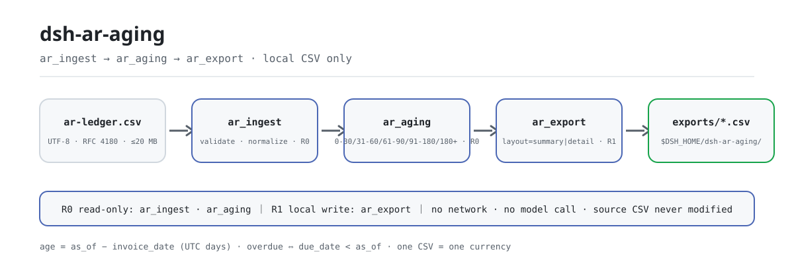
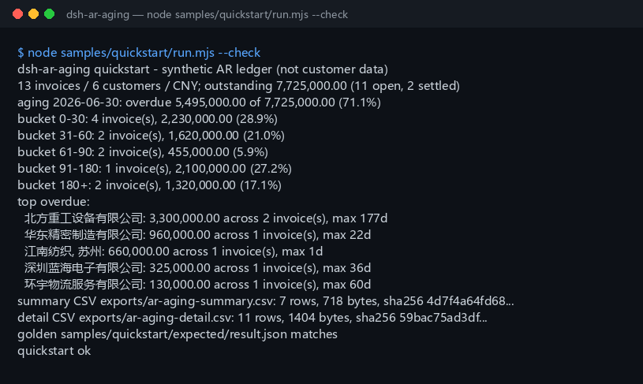

<div align="center">

<picture>
  <source media="(prefers-color-scheme: dark)" srcset="docs/assets/dsh-ar-aging-flow-dark.svg">
  
</picture>

# dsh-ar-aging

**AR लेजर CSV को एजिंग रिपोर्ट में बदलता है: श्रेणियाँ, ग्राहक सारांश, अतिदेय अनुपात और शीर्ष अतिदेय ग्राहक, फिर CSV निर्यात।**

DeepSeek Harness के लिए पूरी तरह लोकल AR एजिंग टूल: तीन टूल एक लोकल CSV पढ़ते हैं, इनवॉइस तिथि से आयु और देय तिथि से अतिदेय मापते हैं — कोई नेटवर्क नहीं, कोई मॉडल कॉल नहीं, कोई अपलोड नहीं।

[इंस्टॉल](#तीन-चरणों-में-शुरुआत) · [कॉन्फ़िगरेशन](#कॉन्फ़िगरेशन) · [FAQ](#faq) · [简体中文](README.md) · [English](README.en.md) · [Español](README.es.md) · [Português](README.pt.md) · [हिन्दी](README.hi.md)

[](LICENSE)
[](#संगतता)
[](https://www.npmjs.com/package/dsh-ar-aging)
[](https://github.com/PerryLink/dsh-ar-aging/actions/workflows/ci.yml)
[](#संगतता)

[](https://github.com/PerryLink/dsh-ar-aging/stargazers)
[](https://www.npmjs.com/package/dsh-ar-aging)
[](https://dshfind.com/plugins/PerryLink/dsh-ar-aging?ref=badge)
[](https://gitee.com/perrylink/dsh-ar-aging)

```sh
dsh plugin --profile <profile> add dsh-ar-aging
```

</div>

<sub>सामुदायिक प्लगइन, DeepSeek से असंबद्ध। कैननिकल रिपॉज़िटरी: <https://github.com/PerryLink/dsh-ar-aging> (Gitee एक मिरर है)।</sub>

<sub>स्थिति: alpha / सार्वजनिक-सिंथेटिक / partial / not counted / GA नहीं — कोई ग्राहक डेटा नहीं, कोई ग्राहक साक्ष्य नहीं, और प्रोडक्शन-तैयारी या ऑडिट-निष्कर्ष का कोई दावा नहीं।</sub>

## यह क्या है

एक पंक्ति में: एक लोकल AR लेजर CSV पढ़ता है, इनवॉइस तिथि से आयु (`as_of - invoice_date`) और देय तिथि से अतिदेय (`due_date < as_of`) मापता है, और पाँच स्थिर श्रेणियों की एजिंग तालिका, ग्राहक सारांश, अतिदेय अनुपात और शीर्ष अतिदेय सूची बनाता है — फिर परिणाम CSV के रूप में निर्यात करता है।

- **उपयुक्त**: ERP या लेखा प्रणाली से निर्यात की गई दसों से हज़ारों पंक्तियाँ; 0-30 / 31-60 / 61-90 / 91-180 / 180+ एजिंग तालिका; वसूली समीक्षा के लिए अतिदेय अनुपात और शीर्ष-अतिदेय सूची; वित्त को सौंपने या संग्रहीत करने के लिए CSV।
- **अनुपयुक्त**: कई मुद्राओं को एक में बदलना (यहाँ FX नहीं है); राइट-ऑफ, डूबत-ऋण प्रावधान, मूल्यह्रास या वसूली सलाह; PDF, स्कैन या Excel सीधे इनपुट के रूप में (पहले CSV निर्यात करें); किसी ऑडिटर, कर सलाहकार या ऋण निर्णय का विकल्प; क्रेडिट नोट / ऋणात्मक इनवॉइस।

## तीन चरणों में शुरुआत

1. **इंस्टॉल करें** (एक चैनल चुनें):

   ```sh
   # npm चैनल (अनुशंसित; प्रकाशित संस्करण)
   dsh plugin --profile <profile> add dsh-ar-aging
   # git चैनल (नवीनतम main; git+https://github.com/PerryLink/dsh-ar-aging.git के समतुल्य)
   dsh plugin --profile <profile> add github:PerryLink/dsh-ar-aging
   # tarball चैनल: इस रेपो में pnpm pack, फिर
   dsh plugin --profile <profile> add ./dsh-ar-aging-<version>.tgz
   ```

2. **न्यूनतम कॉन्फ़िगरेशन** (कोई Config कुंजी नहीं; `cordis.patch.yml` केवल यह पंक्ति जोड़ता है):

   ```yaml
   - insert:
       - id: dsh-ar-aging
         name: dsh-ar-aging
   ```

3. **सत्यापित करें कि माउंट हुआ**:

   ```sh
   dsh --profile <profile> --dump-config | grep dsh-ar-aging
   node samples/quickstart/run.mjs --check
   ```

**अनइंस्टॉल**: `dsh plugin --profile <profile> remove dsh-ar-aging` (या प्रोफ़ाइल पैच से वह पंक्ति हटाएँ)।

## मुख्य क्षमताएँ

टूल नाम स्थिर API हैं; रनटाइम आउटपुट से मिलान के लिए विवरण अंग्रेज़ी में रहते हैं।

| टूल | उद्देश्य | जोखिम |
|---|---|---|
| `ar.ingest` | AR CSV मान्य व सामान्यीकृत करता है; कुल योग, निपटी/खुली संख्याएँ और 5-पंक्ति पूर्वावलोकन लौटाता है | R0 |
| `ar.aging` | `as_of` पर पाँच एजिंग श्रेणियाँ, ग्राहक सारांश, अतिदेय अनुपात और शीर्ष अतिदेय ग्राहक बनाता है | R0 |
| `ar.export` | ग्राहक एजिंग तालिका (`summary`) या इनवॉइस-स्तरीय विवरण (`detail`) CSV के रूप में लिखता है, पथ + sha256 लौटाता है | R1 लोकल राइट |

- **पाँच स्थिर श्रेणियाँ** — `0-30` / `31-60` / `61-90` / `91-180` / `180+`; आयु इनवॉइस तिथि से और अतिदेय देय तिथि से मापा जाता है, दोनों कभी नहीं मिलते।
- **ग्राहक सारांश और शीर्ष अतिदेय** — ग्राहक बकाया अवरोही क्रम में; शीर्ष अतिदेय अतिदेय राशि, फिर सबसे लंबे अतिदेय दिनों के क्रम में; `top_n` 1–50 स्वीकार करता है (डिफ़ॉल्ट 5)।
- **दो निर्यात लेआउट** — `layout=summary` ग्राहक × श्रेणी + `TOTAL` पंक्ति है, `layout=detail` प्रत्येक खुली इनवॉइस पर एक पंक्ति; हर निर्यात `sha256` चेकसम लौटाता है।
- **केवल लोकल, शून्य रनटाइम निर्भरताएँ** — कोई नेटवर्क नहीं, कोई मॉडल कॉल नहीं, कोई अपलोड नहीं; स्रोत CSV केवल-पठन है और कभी संशोधित नहीं होती।
- **अगली कार्रवाई सहित त्रुटियाँ** — हर त्रुटि का प्रारूप `<एक वाक्य>（E_AR_XXX）｜下一步：<एक कार्रवाई>` है; देखें «त्रुटि कोड»।

## इनपुट

- हेडर पंक्ति और अल्पविराम विभाजक वाला UTF-8 CSV। उद्धृत अल्पविराम, एम्बेडेड न्यूलाइन और दोहरे उद्धरण (RFC 4180) समर्थित हैं, साथ ही CRLF और UTF-8 BOM भी।
- हेडर (चीनी उपनाम भी चलते हैं; अतिरिक्त कॉलम अनदेखे होते हैं):

  ```text
  customer,invoice_no,invoice_date,due_date,amount_cents,currency,paid_cents
  客户 / 发票号 / 开票日 / 到期日 / 金额分 / 币种 / 已收金额分
  ```

- तिथियाँ: `YYYY-MM-DD`; `due_date` `invoice_date` से पहले नहीं हो सकती।
- राशियाँ: पूर्णांक **सेंट**; `amount_cents > 0` और `0 <= paid_cents <= amount_cents`।
- मुद्रा: `CNY` जैसा 3-अक्षरीय कोड। **एक CSV में एक ही मुद्रा**; मिलाने पर `E_AR_CSV_ROW`।
- इनवॉइस नंबर फ़ाइल के भीतर अद्वितीय होने चाहिए।
- आकार: प्रति फ़ाइल 20 MB तक; उससे अधिक पर ग्राहक या महीने के अनुसार विभाजित करें।
- स्रोत: उपयोगकर्ता द्वारा बताई गई लोकल CSV; वह केवल-पठन है और कभी संशोधित नहीं होती।

## आउटपुट

- `ar.ingest`: `{ source_sha256, rows, customers, currency, invoice_date_min, invoice_date_max, due_date_min, due_date_max, total_cents, paid_cents, outstanding_cents, settled_rows, open_rows, preview }`। `preview` में पहली पाँच सामान्यीकृत पंक्तियाँ होती हैं।
- `ar.aging`: `{ as_of, currency, totals, buckets, customers, top_overdue }`। `totals` में बकाया, अतिदेय, अदेय और `overdue_ratio` होता है; `buckets` हमेशा पाँच श्रेणियाँ; `customers` बकाया क्रम से क्रमबद्ध; `top_overdue` डिफ़ॉल्ट पाँच ग्राहक (`top_n` 1–50 स्वीकार करता है)।
- `ar.export`: एजिंग तालिका `$DSH_HOME/dsh-ar-aging/exports/` के तहत लिखता है और पथ, `sha256`, बाइट्स और पंक्तियाँ लौटाता है। `layout=summary` (डिफ़ॉल्ट) ग्राहक × श्रेणी + `TOTAL` पंक्ति है; `layout=detail` प्रत्येक खुली इनवॉइस पर एक पंक्ति। स्रोत CSV अछूती रहती है।

### एजिंग नियम

1. आयु = `as_of - invoice_date` पूरे UTC दिनों में। किसी भी इनवॉइस तिथि से पहले का `as_of` `E_AR_DATE_INVALID` उठाता है।
2. श्रेणियाँ: `0-30` (0–30), `31-60` (31–60), `61-90` (61–90), `91-180` (91–180), `180+` (181+)।
3. अतिदेय: `due_date < as_of` और बकाया > 0; आज देय होना अतिदेय नहीं है।
4. अतिदेय अनुपात = अतिदेय बकाया ÷ कुल बकाया, 4 दशमलव तक पूर्णांकित (0.7113 = 71.13%)।
5. ग्राहक बकाया अवरोही, फिर नाम आरोही क्रम में। शीर्ष अतिदेय अतिदेय राशि, फिर सबसे लंबे अतिदेय दिनों के क्रम में।
6. summary CSV की अंतिम पंक्ति `TOTAL` होती है; detail CSV में केवल खुली इनवॉइस, ग्राहक, देय तिथि और इनवॉइस नंबर के क्रम में।

पूरी तरह चुकी गई इनवॉइस (`paid_cents = amount_cents`) `settled_rows` में गिनी जाती है, लेकिन श्रेणियों और detail निर्यात से बाहर रहती है।

## उदाहरण

यह एक पंक्ति एजेंट में चिपकाएँ:

```text
我有这份应收明细，按 2026-06-30 出账龄表：分桶、客户汇总和 Top 逾期客户，再导出 CSV。
```

बंडल किया नमूना दोहराएँ और गोल्डन फ़ाइल से तुलना करें:

```sh
node samples/quickstart/run.mjs --check
```



नमूना एक मुद्रा (CNY) में 6 ग्राहकों वाला 13-पंक्तियों का सिंथेटिक लेजर है। इसमें पाँचों श्रेणियाँ, एक आंशिक भुगतान, दो निपटी इनवॉइस और अल्पविराम वाला एक ग्राहक नाम शामिल है, जो RFC 4180 के अनुसार उद्धृत है (`samples/quickstart/input/ar-ledger.csv` से हूबहू):

```text
"江南纺织, 苏州",INV-2026-0031,2026-01-18,2026-02-17,88000000,CNY,88000000
```

`samples/quickstart/expected/result.json` `node samples/quickstart/run.mjs --json` का वास्तविक stdout है, हाथ से लिखा नहीं। ऊपर का स्क्रीनशॉट उसी कमांड का वास्तविक आउटपुट है (कच्चा लॉग [`docs/assets/quickstart.log`](docs/assets/quickstart.log) में)।

## कॉन्फ़िगरेशन

इस प्लगइन में **कोई Config कुंजी नहीं** है — सब कुछ तीनों टूल के कॉल पैरामीटर से समायोजित होता है:

| टूल | पैरामीटर | आवश्यक | अर्थ |
|---|---|---|---|
| `ar.ingest` | `path` | हाँ | AR लेजर CSV का निरपेक्ष पथ |
| `ar.aging` | `path`, `as_of` | हाँ | `as_of` एजिंग संदर्भ तिथि है (`YYYY-MM-DD`); पुनरुत्पाद्य «आज» के लिए स्पष्ट रूप से दें |
| `ar.aging` | `top_n` | नहीं | शीर्ष अतिदेय ग्राहकों की संख्या, 1–50, डिफ़ॉल्ट 5 |
| `ar.export` | `path`, `as_of` | हाँ | ऊपर जैसा |
| `ar.export` | `layout` | नहीं | `summary` (डिफ़ॉल्ट) या `detail` |
| `ar.export` | `filename` | नहीं | निर्यात फ़ाइलनाम, केवल `[A-Za-z0-9._-]`; डिफ़ॉल्ट `ar-aging-<as_of>-<layout>.csv` |

कॉल उदाहरण (टूल सतह):

```sh
# 1) मान्य करें और कुल देखें
#    टूल सतह: ar.ingest({ path: "/abs/path/ar-ledger.csv" })

# 2) एजिंग रिपोर्ट बनाएँ
#    टूल सतह: ar.aging({ path: "/abs/path/ar-ledger.csv", as_of: "2026-06-30", top_n: 5 })

# 3) CSV निर्यात करें
#    टूल सतह: ar.export({ path: "/abs/path/ar-ledger.csv", as_of: "2026-06-30", layout: "summary" })
```

परीक्षण `DSH_AR_AGING_HOME` पर्यावरण चर से लोकल राइट रूट बदल सकते हैं; डिफ़ॉल्ट ठीक-ठीक `$DSH_HOME/dsh-ar-aging` है।

## FAQ

<details>
<summary>आयु इनवॉइस तिथि से मापी जाती है या देय तिथि से?</summary>

**इनवॉइस तिथि** से (`as_of - invoice_date`)। अतिदेय अलग से **देय तिथि** से मापा जाता है (`due_date < as_of`)। 100 दिन पुरानी लेकिन अभी अदेय इनवॉइस `91-180` में आती है, अतिदेय राशि शून्य के साथ।

</details>

<details>
<summary>कई मुद्राओं का क्या?</summary>

एक CSV में एक ही मुद्रा; मिलाने पर `E_AR_CSV_ROW`। यहाँ FX रूपांतरण या क्रॉस-मुद्रा योग नहीं है। फ़ाइल को मुद्रा के अनुसार विभाजित करें, या पहले स्रोत प्रणाली में बदल लें।

</details>

<details>
<summary>आंशिक भुगतान और निपटी इनवॉइस का क्या होता है?</summary>

बकाया = `amount_cents - paid_cents`। आंशिक भुगतान अपने बकाया शेष से एजिंग में आते हैं। पूरी तरह चुकी इनवॉइस `settled_rows` में गिनी जाती है, लेकिन श्रेणियों, ग्राहक सारांश और detail निर्यात से बाहर रहती है। `paid_cents > amount_cents` पर `E_AR_AMOUNT`।

</details>

<details>
<summary>राशियाँ युआन में हैं या सेंट में?</summary>

टूल API हर जगह पूर्णांक **सेंट** उपयोग करता है। `128000000` का अर्थ 1,280,000.00 है। निर्यातित CSV दो दशमलव के साथ फ़ॉर्मेट होता है ताकि स्प्रेडशीट सीधे खोल सके।

</details>

<details>
<summary>क्या यह मेरी फ़ाइल बदलता या अपलोड करता है?</summary>

नहीं। यह बताई गई CSV पढ़ता है, केवल `$DSH_HOME/dsh-ar-aging/exports/` के तहत लिखता है, और कभी नेटवर्क, मॉडल कॉल या अपलोड का उपयोग नहीं करता।

</details>

## अनुमतियाँ

पढ़ना: उपयोगकर्ता द्वारा बताई गई AR लेजर CSV (नमूना: `samples/quickstart/input/ar-ledger.csv`); और कुछ नहीं।
लिखना: केवल `$DSH_HOME/dsh-ar-aging/exports/`; स्रोत CSV संशोधित नहीं होती।
नेटवर्क: नहीं।
बाहरी सिस्टम: कोई नहीं।

`ar.ingest` और `ar.aging` **R0** हैं (केवल-पठन)। `ar.export` **R1** है (`$DSH_HOME/dsh-ar-aging/exports/` के तहत लोकल राइट)। परीक्षणों के लिए `DSH_AR_AGING_HOME` लोकल राइट रूट बदल सकता है; डिफ़ॉल्ट ठीक-ठीक `$DSH_HOME/dsh-ar-aging` है।

## त्रुटि कोड

| कोड | कब | अगली कार्रवाई |
|---|---|---|
| `E_AR_CSV_ROW` | गलत कॉलम संख्या, हेडर गायब, खाली ग्राहक/इनवॉइस, डुप्लिकेट इनवॉइस, मिश्रित मुद्रा, खाली या >20 MB फ़ाइल | बताई गई पंक्ति ठीक करें, मुद्रा या महीने से विभाजित करें |
| `E_AR_DATE_INVALID` | `YYYY-MM-DD` नहीं, असंभव तिथि, देय तिथि इनवॉइस से पहले, `as_of` किसी इनवॉइस से पहले | ISO तिथियाँ उपयोग करें और क्रम जाँचें |
| `E_AR_AMOUNT` | गैर-ऋणात्मक पूर्णांक सेंट नहीं, शून्य राशि, राशि से अधिक भुगतान | पूर्णांक सेंट उपयोग करें और `0 <= paid <= amount` |
| `E_AR_PATH_INVALID` | इनपुट गायब / डायरेक्टरी है / अपठनीय, निर्यात डायरेक्टरी अलेखनीय, या असुरक्षित निर्यात फ़ाइलनाम | मौजूदा CSV दें; केवल `[A-Za-z0-9._-]` नाम से निर्यात करें |

संदेश का प्रारूप है:

```text
<एक वाक्य>（E_AR_XXX）｜下一步：<एक कार्रवाई>
```

अधिक समस्या-निवारण के लिए [TROUBLESHOOTING.md](TROUBLESHOOTING.md) देखें।

## स्वीकृति साक्ष्य

सार्वजनिक/सिंथेटिक fixture `samples/quickstart/` में हैं; `ACCEPTANCE.csv` जाँचें दर्ज करता है। quickstart पंक्ति को छोड़कर हर पंक्ति `counted=false` है।

| req_id | metric | threshold | actual | pass | source | counted |
|---|---|---|---|---|---|---|
| AR-A01 | ingest totals | rows=13 customers=6 | rows=13 customers=6 | true | public/synthetic | false |
| AR-A02 | aging buckets | counts=4/2/2/1/2 | counts=4/2/2/1/2 | true | public/synthetic | false |
| AR-A03 | overdue ratio | overdue=549500000 ratio=0.7113 | overdue=549500000 ratio=0.7113 | true | public/synthetic | false |
| PS1-QS01 | quickstart golden | 1/1 | 1 | true | synthetic/quickstart | true |

*Fixture-समर्थित पंक्तियाँ, ग्राहक रन नहीं; कोई आउटपुट नहीं बनाया गया।*

## सीमाएँ और ज्ञात सीमाएँ

- **एकल मुद्रा**: FX रूपांतरण नहीं; फ़ाइलें मुद्रा के अनुसार विभाजित करें।
- **कोई क्रेडिट नोट नहीं**: `amount_cents` > 0 होना चाहिए। रेड-इनवॉइस / क्रेडिट नोट पहले स्रोत प्रणाली में ऑफसेट करें।
- केवल एजिंग और अतिदेय आँकड़े: कोई राइट-ऑफ, डूबत-ऋण प्रावधान, मूल्यह्रास, वसूली रणनीति या ऑडिट राय नहीं।
- केवल CSV: कोई PDF, स्कैन या Excel नहीं, और OCR नहीं। पहले स्रोत प्रणाली से CSV निर्यात करें।
- राशि की परिशुद्धता एक सेंट है; तिथियाँ UTC कैलेंडर दिन उपयोग करती हैं। पुनरुत्पाद्य «आज» के लिए `as_of` स्पष्ट रूप से दें।
- निर्यातित CSV केवल RFC 4180 उद्धरण उपयोग करता है; Excel सूत्र उपसर्ग सैनिटाइज़ नहीं किए जाते।
- केवल लोकल: कोई नेटवर्क नहीं, कोई मॉडल कॉल नहीं, कोई अपलोड नहीं।
- केवल सार्वजनिक/सिंथेटिक नमूने; alpha/partial, not counted, GA या प्रोडक्शन-तैयारी का कोई दावा नहीं।

## संगतता

| सतह | स्थिति |
|---|---|
| Harness | `dsh >=0.2.1-rc.3 <0.4.0` |
| Node | `>=24.9.0 <25` |
| प्लेटफ़ॉर्म | सभी; केवल लोकल फ़ाइलें |
| डेटा | कोई नेटवर्क नहीं, कोई मॉडल कॉल नहीं, कोई अपलोड नहीं |

## पारिस्थितिकी तंत्र और गुणवत्ता

- [Gitee मिरर](https://gitee.com/perrylink/dsh-ar-aging) (सिंक मिरर; GitHub कैननिकल है)
- [dshfind प्लगइन पेज](https://dshfind.com/plugins/PerryLink/dsh-ar-aging) (इंस्टॉल और रैंकिंग)
- **1024 स्टोर चैनल**: एक बार `npm i -g dsh1024`, फिर `dsh1024 plugin --profile <profile> add dsh-ar-aging` ([deepseek1024.com](https://deepseek1024.com) इंस्टॉल रैंकिंग में गिना जाता है)
- [पारिस्थितिकी तंत्र ज्ञानकोश](https://perrylink.github.io/dsh-plugin-guide/) — प्लगइन विकास मार्गदर्शिका · मापा गया चयन डेटा · रखरखाव मानदंड

## संबंधित प्रोजेक्ट

- [dsh-bankrec](https://github.com/PerryLink/dsh-bankrec) (बैंक स्टेटमेंट समाधान)
- [dsh-fin-invoice-core](https://github.com/PerryLink/dsh-fin-invoice-core) (इनवॉइस कोर लॉजिक)
- [डोमेन सूची](https://perrylink.github.io/dsh-plugins/)

## विकास

```sh
pnpm install --frozen-lockfile
pnpm build && pnpm lint && pnpm typecheck
node --test test/*.test.mjs
node scripts/gate.mjs
```

वर्तमान संस्करण `0.1.0`; 53 परीक्षण पास (`node --test test/*.test.mjs`)। रिलीज़ गेट: `node scripts/gate.mjs` (मेटाडेटा lint + सभी सार्वजनिक स्वीकृति पंक्तियाँ पास + चारों स्थिर त्रुटि कोड प्रयुक्त)। शीर्षक का पाइपलाइन आरेख [`scripts/gen-readme-assets.py`](scripts/gen-readme-assets.py) द्वारा प्रोग्रामेटिक रूप से बनता है (Python मानक लाइब्रेरी, शुद्ध SVG, कमांड-टोकन लेबल, हल्का/गहरा जोड़ा) और सुरक्षित रूप से दोबारा चलाया जा सकता है; `docs/assets/quickstart.png` वास्तविक कैप्चर किया गया स्क्रीनशॉट है, `docs/assets/quickstart.log` के साथ सुरक्षित।

Topics: `dsh`, `dsh-plugin`, `deepseek-harness`, `accounts-receivable`, `ar-aging`, `aging-report`, `finance`, `csv`, `perrylink`

## परिवार और आभार

यह प्रोजेक्ट [PerryLink](https://github.com/PerryLink) के DeepSeek Harness प्लगइन परिवार का हिस्सा है (सभी Apache-2.0)। यदि यह उपयोगी लगे, **एक स्टार अगले व्यक्ति को इसे खोजने में मदद करता है** — उसके पीछे कुछ भी लॉक नहीं है।

- [@PerryLink](https://github.com/PerryLink) — निर्माता और अनुरक्षक: एजिंग इंजन, CSV पार्सर व एक्सपोर्टर, तीनों टूल सतहें, quickstart गोल्डन नमूना और पाँच-भाषा दस्तावेज़।

## लाइसेंस

[LICENSE](LICENSE) (Apache License 2.0) © 2026 dsh-ar-aging contributors। `NOTICE` और `THIRD-PARTY-NOTICES` भी देखें।

<p align="center"><sub>Apache-2.0 · सामुदायिक प्लगइन, DeepSeek से असंबद्ध।</sub></p>
