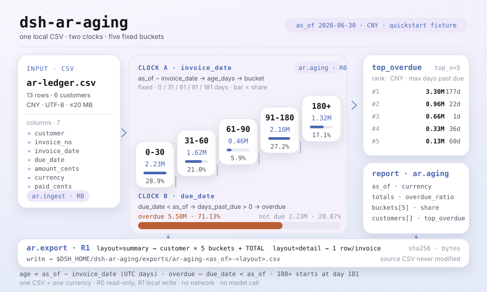
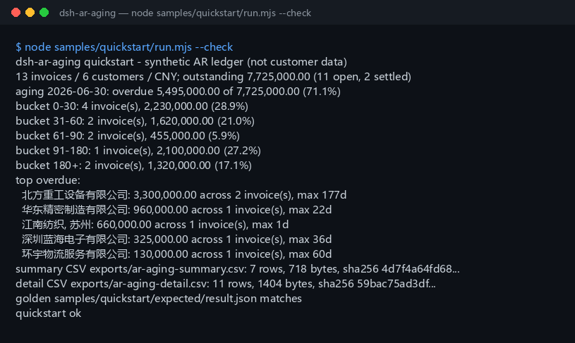

<div align="center">

<picture>
  <source media="(prefers-color-scheme: dark)" srcset="docs/assets/dsh-ar-aging-hero-zh-dark.webp">
  
</picture>

# dsh-ar-aging

**把应收明细 CSV 变成账龄表：分桶、客户汇总、逾期占比、Top 逾期客户，再导出 CSV。**

面向 DeepSeek Harness 的纯本地应收账龄工具：三个工具读一份本地 CSV，按开票日算账龄、按到期日算逾期，全部计算在本机完成——不联网、不调用模型、不上传。

[安装](#三步上手) · [配置](#配置) · [FAQ](#faq) · [简体中文](README.md) · [English](README.en.md) · [Español](README.es.md) · [Português](README.pt.md) · [हिन्दी](README.hi.md)

[](LICENSE)
[](#兼容性)
[](https://www.npmjs.com/package/dsh-ar-aging)
[](https://github.com/PerryLink/dsh-ar-aging/actions/workflows/ci.yml)
[](#兼容性)

[](https://github.com/PerryLink/dsh-ar-aging/stargazers)
[](https://www.npmjs.com/package/dsh-ar-aging)
[](https://dshfind.com/plugins/PerryLink/dsh-ar-aging?ref=badge)
[](https://gitee.com/perrylink/dsh-ar-aging)

```sh
dsh plugin --profile <profile> add dsh-ar-aging
```

</div>

<sub>社区插件，与 DeepSeek 官方无关。唯一仓库：<https://github.com/PerryLink/dsh-ar-aging>（Gitee 为镜像）。</sub>

<sub>状态：alpha / 公开合成 / partial / not counted / 非 GA——不含客户数据、客户证据，也不作生产可用或审计结论声明。</sub>

## 它是什么

一句话：读一份本地应收明细 CSV，按开票日算账龄（`as_of - invoice_date`）、按到期日算逾期（`due_date < as_of`），输出固定五桶的账龄表、客户汇总、逾期占比和 Top 逾期客户，并把结果导出成 CSV。

- **适合**：几十到几千行、由 ERP / 财务系统导出的应收明细；需要按 0-30 / 31-60 / 61-90 / 91-180 / 180+ 出账龄表、看逾期占比和 Top 逾期客户；需要把结果落成 CSV 交给财务复核或归档。
- **不适合**：多币种需要折算成一种货币（本包不做汇率）；需要核销、坏账准备、减值或催收建议；PDF / 扫描件 / Excel 直接输入（请先导出成 CSV）；替代审计师或税务师判断；带负数金额的贷记单 / 红字发票。

<picture>
  <source media="(prefers-color-scheme: dark)" srcset="docs/assets/dsh-ar-aging-flow-v5-dark.svg">
  
</picture>

## 三步上手

1. **安装**（三选一）：

   ```sh
   # npm 通道（推荐，已发布版本）
   dsh plugin --profile <profile> add dsh-ar-aging
   # git 通道（最新 main；等价于 git+https://github.com/PerryLink/dsh-ar-aging.git）
   dsh plugin --profile <profile> add github:PerryLink/dsh-ar-aging
   # tarball 通道：本仓库 pnpm pack 后
   dsh plugin --profile <profile> add ./dsh-ar-aging-<version>.tgz
   ```

2. **最小配置**（无需任何 Config 键，`cordis.patch.yml` 只插入这一行）：

   ```yaml
   - insert:
       - id: dsh-ar-aging
         name: dsh-ar-aging
   ```

3. **验证已生效**：

   ```sh
   dsh --profile <profile> --dump-config | grep dsh-ar-aging
   node samples/quickstart/run.mjs --check
   ```

**卸载**：`dsh plugin --profile <profile> remove dsh-ar-aging`（或从 profile patch 删掉该行）。

## 核心能力

工具名是稳定 API；工具说明保留英文以匹配运行时输出。

| 工具 | 用途 | 风险 |
|---|---|---|
| `ar_ingest` | 校验并规范化应收明细 CSV，返回总数、已结清/未收行数和 5 行预览 | R0 |
| `ar_aging` | 按 `as_of` 出 5 个账龄桶、客户汇总、逾期占比和 Top 逾期客户 | R0 |
| `ar_export` | 导出客户账龄表（summary）或逐票明细（detail）CSV，返回路径与 sha256 | R1 本地写 |

- **固定五桶账龄** —— `0-30` / `31-60` / `61-90` / `91-180` / `180+`，账龄从开票日起算，逾期从到期日起算，两个口径互不混淆。
- **客户汇总与 Top 逾期** —— 客户按未收金额降序，Top 逾期按逾期金额再按最长逾期天数排序，`top_n` 可调（1–50，默认 5）。
- **两种导出布局** —— `layout=summary` 是客户 × 分桶加 `TOTAL` 行，`layout=detail` 是每个未收发票一行；导出文件带 `sha256` 校验值。
- **纯本地、零运行时依赖** —— 不联网、不调用模型、不上传；源 CSV 只读，永不修改。
- **报错带下一步动作** —— 每个错误都是 `<一句人话>（E_AR_XXX）｜下一步：<一个动作>`，见「错误码」。

## 输入

- 格式：UTF-8 CSV，首行表头，逗号分隔；支持带引号的逗号、换行和双引号（RFC 4180），支持 CRLF 和 BOM。
- 表头：`customer,invoice_no,invoice_date,due_date,amount_cents,currency,paid_cents`。也接受 `客户 / 发票号 / 开票日 / 到期日 / 金额分 / 币种 / 已收金额分` 等中文别名；多出的列会被忽略。
- 日期：`YYYY-MM-DD`；`due_date` 不能早于 `invoice_date`。
- 金额：整数**分**；`amount_cents > 0`，`0 <= paid_cents <= amount_cents`。
- 币种：3 位字母代码（如 `CNY`）；**一份 CSV 只能有一种币种**，混用会报 `E_AR_CSV_ROW`。
- 发票号：同一文件内不能重复。
- 大小：单个文件 ≤ 20 MB；超过请按客户或月份拆文件。
- 来源：用户自己指定的本地 CSV；原文件只读，不会被修改。

## 输出

- `ar_ingest`：`{ source_sha256, rows, customers, currency, invoice_date_min, invoice_date_max, due_date_min, due_date_max, total_cents, paid_cents, outstanding_cents, settled_rows, open_rows, preview }`。`preview` 是前 5 行规范化结果。
- `ar_aging`：`{ as_of, currency, totals, buckets, customers, top_overdue }`。`totals` 含未收、逾期、未到期和 `overdue_ratio`；`buckets` 固定 5 桶；`customers` 按未收降序；`top_overdue` 默认 5 个客户（`top_n` 可调，1–50）。
- `ar_export`：把账龄表写到 `$DSH_HOME/dsh-ar-aging/exports/`，返回路径、`sha256`、字节数、行数。`layout=summary`（默认）是客户 × 分桶 + `TOTAL` 行；`layout=detail` 是每个未收发票一行。原 CSV 不改。

### 账龄规则

1. 账龄天数 = `as_of - invoice_date`，按 UTC 日历日取整；`as_of` 早于任一开票日 → `E_AR_DATE_INVALID`。
2. 分桶：`0-30`（0–30 天）、`31-60`（31–60）、`61-90`（61–90）、`91-180`（91–180）、`180+`（181 天及以上）。
3. 逾期：`due_date < as_of` 且未收 > 0；到期日当天算未到期。
4. 逾期占比 = 逾期未收 ÷ 未收总额，保留 4 位小数（0.7113 = 71.13%）。
5. 客户汇总按未收金额降序，金额相同按客户名升序；Top 逾期按逾期金额降序，再按最长逾期天数降序。
6. 导出的 summary 最后一行为 `TOTAL`；detail 只含未收发票，按客户、到期日、发票号排序。

已结清的发票（`paid_cents = amount_cents`）计入 `settled_rows`，但不进入分桶和明细导出。

## 示例

直接复制下面这句发给 agent：

```text
我有这份应收明细，按 2026-06-30 出账龄表：分桶、客户汇总和 Top 逾期客户，再导出 CSV。
```

用自带样例复跑并核对金标：

```sh
node samples/quickstart/run.mjs --check
```



样例是 13 行合成应收明细、6 个客户、单一币种 CNY，覆盖全部 5 个分桶、1 张部分收款、2 张已结清，以及一个带逗号的客户名（`江南纺织, 苏州`，用于验证 CSV 引号转义）。金标 `samples/quickstart/expected/result.json` 由 `node samples/quickstart/run.mjs --json` 真实产生，不是手写。截图就是上面这条命令的真实输出（原始日志见 [`docs/assets/quickstart.log`](docs/assets/quickstart.log)）。

## 配置

本插件**没有 Config 键**——挂载后即全部可用，所有可调项都在三个工具的调用参数上：

| 工具 | 参数 | 必填 | 含义 |
|---|---|---|---|
| `ar_ingest` | `path` | 是 | 应收明细 CSV 的绝对路径 |
| `ar_aging` | `path`、`as_of` | 是 | `as_of` 为账龄基准日（`YYYY-MM-DD`），显式传入可复现「今天」 |
| `ar_aging` | `top_n` | 否 | Top 逾期客户数量，1–50，默认 5 |
| `ar_export` | `path`、`as_of` | 是 | 同上 |
| `ar_export` | `layout` | 否 | `summary`（默认）或 `detail` |
| `ar_export` | `filename` | 否 | 导出文件名，只允许 `[A-Za-z0-9._-]`；默认 `ar-aging-<as_of>-<layout>.csv` |

调用示例（工具面）：

```sh
# 1) 校验并看总数
#    工具面：ar_ingest({ path: "/abs/path/ar-ledger.csv" })

# 2) 出账龄表
#    工具面：ar_aging({ path: "/abs/path/ar-ledger.csv", as_of: "2026-06-30", top_n: 5 })

# 3) 导出 CSV
#    工具面：ar_export({ path: "/abs/path/ar-ledger.csv", as_of: "2026-06-30", layout: "summary" })
```

测试可用环境变量 `DSH_AR_AGING_HOME` 覆盖本地写根目录；默认严格等于 `$DSH_HOME/dsh-ar-aging`。

## FAQ

<details>
<summary>账龄按开票日还是到期日算？</summary>

按**开票日**算账龄（`as_of - invoice_date`），按**到期日**算逾期（`due_date < as_of`）。两者分开，所以一张 100 天账龄但还没到期的发票会落在 `91-180` 桶，同时逾期金额为 0。

</details>

<details>
<summary>多币种怎么办？</summary>

一份 CSV 只允许一种币种，混用会直接报 `E_AR_CSV_ROW`。本包不做汇率折算，也不把不同币种加在一起；请按币种拆成多个 CSV 分别运行，或先在源系统折算好再导出。

</details>

<details>
<summary>部分收款和已结清怎么处理？</summary>

未收 = `amount_cents - paid_cents`。部分收款按未收余额进入账龄；`paid_cents = amount_cents` 的发票只计入 `settled_rows`，不进入分桶、客户汇总和明细导出。`paid_cents > amount_cents` 会报 `E_AR_AMOUNT`。

</details>

<details>
<summary>金额单位是元还是分？</summary>

输入和输出 API 都是**整数分**。`128000000` 表示 1,280,000.00 元。导出的 CSV 会格式化成两位小数，方便直接用表格软件打开。

</details>

<details>
<summary>会改我的文件或上传数据吗？</summary>

不会。只读用户指定的 CSV；只在本地写 `$DSH_HOME/dsh-ar-aging/exports/`；不联网、不调用模型、不上传。

</details>

## 权限

读：用户指定的应收明细 CSV（样例 `samples/quickstart/input/ar-ledger.csv`）；不读其他目录。
写：`$DSH_HOME/dsh-ar-aging/exports/`（CSV 输出）；不改原 CSV。
联网：否。
外部系统：无。

`ar_ingest`、`ar_aging` 标 **R0**（只读）；`ar_export` 标 **R1**（本地写，只写 `$DSH_HOME/dsh-ar-aging/exports/`）。测试可用 `DSH_AR_AGING_HOME` 覆盖本地写根目录，默认严格等于 `$DSH_HOME/dsh-ar-aging`。

## 错误码

| 错误码 | 何时出现 | 下一步 |
|---|---|---|
| `E_AR_CSV_ROW` | 列数不对、表头缺失、客户/发票号为空、发票号重复、币种混用、文件为空或超 20 MB | 对照表头修这一行，按币种/月份拆文件 |
| `E_AR_DATE_INVALID` | 日期不是 `YYYY-MM-DD`、不是真实日期、到期日早于开票日、`as_of` 早于开票日 | 统一日期格式并核对先后顺序 |
| `E_AR_AMOUNT` | 金额分不是非负整数、金额为 0、已收超过应收 | 金额一律填整数分，且 `0 <= paid <= amount` |
| `E_AR_PATH_INVALID` | 输入路径不存在/是目录/读不了、导出目录不可写，或导出文件名含路径、空格、中文、超长 | 传存在的 CSV；导出只传 `[A-Za-z0-9._-]` 文件名 |

报错原文格式：`<一句人话>（E_AR_XXX）｜下一步：<一个动作>`。更多排查见 [TROUBLESHOOTING.md](TROUBLESHOOTING.md)。

## 验收证据

公开/合成 fixture 在 `samples/quickstart/`；`ACCEPTANCE.csv` 记录检查，除 quickstart 行外均为 `counted=false`。

| req_id | metric | threshold | actual | pass | source | counted |
|---|---|---|---|---|---|---|
| AR-A01 | ingest totals | rows=13 customers=6 | rows=13 customers=6 | true | public/synthetic | false |
| AR-A02 | aging buckets | counts=4/2/2/1/2 | counts=4/2/2/1/2 | true | public/synthetic | false |
| AR-A03 | overdue ratio | overdue=549500000 ratio=0.7113 | overdue=549500000 ratio=0.7113 | true | public/synthetic | false |
| PS1-QS01 | quickstart golden | 1/1 | 1 | true | synthetic/quickstart | true |

*这是 fixture 支撑的验收行，不是客户运行；没有编造输出。*

## 边界与已知限制

- **单币种**：不做汇率折算，不同币种必须拆文件。
- **不含贷记单**：`amount_cents` 必须大于 0；红字发票/贷项通知单请先在源系统冲抵。
- 只做账龄与逾期统计：不做核销、坏账准备、减值、催收策略或审计结论。
- 只读 CSV：不读 PDF / 扫描件 / Excel，不做 OCR；请先从源系统导出 CSV。
- 金额精度到分；日期按 UTC 日历日；跨时区的「今天」请显式传 `as_of`。
- 导出 CSV 只做 RFC 4180 引号转义，不做 Excel 公式前缀清洗；不要用 Excel 直接打开来源不明的 CSV。
- 只在本机读写；不联网、不调用模型、不上传。
- 仅公开/合成样例；alpha/partial、not counted，不作 GA 或生产可用声明。

## 兼容性

| 维度 | 状态 |
|---|---|
| Harness | `dsh >=0.2.1-rc.3 <0.4.0` |
| Node | `>=24.9.0 <25` |
| 平台 | 全平台；仅本地文件 |
| 数据 | 不联网、不调用模型、不上传 |

## 生态与质量

- [Gitee 镜像](https://gitee.com/perrylink/dsh-ar-aging)（同步镜像，以 GitHub 为准）
- [dshfind 插件页](https://dshfind.com/plugins/PerryLink/dsh-ar-aging)（安装量与排名）
- **1024 商店渠道**：先 `npm i -g dsh1024`，再 `dsh1024 plugin --profile <profile> add dsh-ar-aging`（计入 [deepseek1024.com](https://deepseek1024.com) 安装排行）
- [生态实测知识库](https://perrylink.github.io/dsh-plugin-guide/)：插件开发指南 · 选型实测数据 · 维护取舍判据

## 相关项目

- [dsh-bankrec](https://github.com/PerryLink/dsh-bankrec)（银行流水对账）
- [dsh-fin-invoice-core](https://github.com/PerryLink/dsh-fin-invoice-core)（发票核心逻辑）
- [领域索引](https://perrylink.github.io/dsh-plugins/)

## 开发

```sh
pnpm install --frozen-lockfile
pnpm build && pnpm lint && pnpm typecheck
node --test test/*.test.mjs
node scripts/gate.mjs
```

当前版本 `0.2.0`，54 项测试通过（`node --test test/*.test.mjs`）。发布门禁：`node scripts/gate.mjs`（元数据 lint + 公开验收行全过 + 四个稳定错误码全被触发）。开头横幅与结构图由 [`scripts/gen-readme-assets.py`](scripts/gen-readme-assets.py) 程序化生成（Pillow 画 1440×576 横幅四张 webp，手写 SVG 画 1100×660 结构图深浅双版），可重复执行；`docs/assets/quickstart.png` 为真实运行截图，配合 `docs/assets/quickstart.log` 保留。

Topics：`dsh`、`dsh-plugin`、`deepseek-harness`、`accounts-receivable`、`ar-aging`、`aging-report`、`finance`、`csv`、`perrylink`

## 家族与致谢

本项目是 [PerryLink](https://github.com/PerryLink) 维护的 DeepSeek Harness 插件家族成员（全部 Apache-2.0）。如果这个插件帮到了你，**给个 star**——它不解锁任何功能，但会让下一个人更容易找到它。

- [@PerryLink](https://github.com/PerryLink) —— 创建者与维护者：账龄引擎、CSV 解析与导出、三个工具面、quickstart 金标样例与五语文档。

## License

[LICENSE](LICENSE)（Apache License 2.0）© 2026 dsh-ar-aging contributors。另见 `NOTICE`、`THIRD-PARTY-NOTICES`。

<p align="center"><sub>Apache-2.0 · 社区插件，与 DeepSeek 无关。</sub></p>
