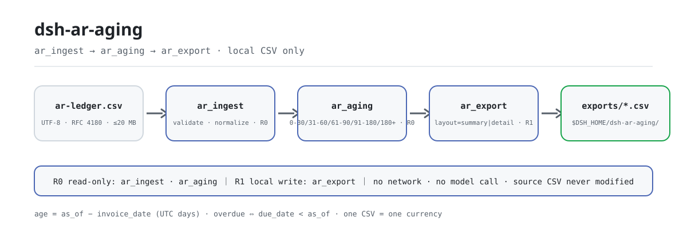
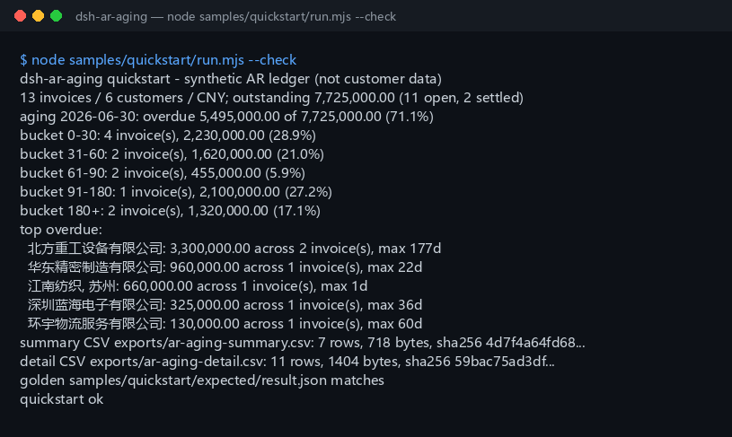

<div align="center">

<picture>
  <source media="(prefers-color-scheme: dark)" srcset="docs/assets/dsh-ar-aging-flow-dark.svg">
  
</picture>

# dsh-ar-aging

**Transforma um razão de contas a receber em CSV em um relatório de aging: faixas, resumo por cliente, índice vencido e principais clientes vencidos, e exporta o resultado em CSV.**

Uma ferramenta de aging de contas a receber puramente local para DeepSeek Harness: três ferramentas leem um CSV local, calculam a idade a partir da data da fatura e o vencimento a partir da data de vencimento — sem rede, sem chamada de modelo, sem upload.

[Instalar](#instalação-em-três-passos) · [Configuração](#configuração) · [FAQ](#faq) · [简体中文](README.md) · [English](README.en.md) · [Español](README.es.md) · [Português](README.pt.md) · [हिन्दी](README.hi.md)

[](LICENSE)
[](#compatibilidade)
[](https://www.npmjs.com/package/dsh-ar-aging)
[](https://github.com/PerryLink/dsh-ar-aging/actions/workflows/ci.yml)
[](#compatibilidade)

[](https://github.com/PerryLink/dsh-ar-aging/stargazers)
[](https://www.npmjs.com/package/dsh-ar-aging)
[](https://dshfind.com/plugins/PerryLink/dsh-ar-aging?ref=badge)
[](https://gitee.com/perrylink/dsh-ar-aging)

```sh
dsh plugin --profile <profile> add dsh-ar-aging
```

</div>

<sub>Plugin da comunidade, não afiliado à DeepSeek. Repositório canônico: <https://github.com/PerryLink/dsh-ar-aging> (Gitee é um espelho).</sub>

<sub>Status: alpha / público-sintético / partial / not counted / não GA — sem dados de clientes, sem evidência de clientes e sem declaração de prontidão para produção nem de conclusão de auditoria.</sub>

## O que é

Em uma frase: lê um CSV local de contas a receber, calcula a idade a partir da data da fatura (`as_of - invoice_date`) e o vencimento a partir da data de vencimento (`due_date < as_of`), e produz uma tabela de cinco faixas fixas, um resumo por cliente, o índice vencido e a lista dos principais clientes vencidos, exportável em CSV.

- **Serve para**: dezenas a milhares de linhas exportadas de um ERP ou sistema contábil; uma tabela de aging 0-30 / 31-60 / 61-90 / 91-180 / 180+; um índice vencido e uma lista de principais vencidos para uma revisão de cobrança; um CSV para entregar ao financeiro ou arquivar.
- **Não serve para**: converter várias moedas em uma (não há FX aqui); baixas, provisão para devedores duvidosos, impairment ou conselhos de cobrança; PDF, digitalizações ou Excel como entrada direta (exporte CSV primeiro); substituir um auditor, consultor fiscal ou decisão de crédito; notas de crédito / faturas negativas.

## Instalação em três passos

1. **Instale** (escolha um canal):

   ```sh
   # canal npm (recomendado; versões publicadas)
   dsh plugin --profile <profile> add dsh-ar-aging
   # canal git (main mais recente; equivalente a git+https://github.com/PerryLink/dsh-ar-aging.git)
   dsh plugin --profile <profile> add github:PerryLink/dsh-ar-aging
   # canal tarball: pnpm pack neste repo e depois
   dsh plugin --profile <profile> add ./dsh-ar-aging-<version>.tgz
   ```

2. **Configuração mínima** (não há nenhuma chave de Config; o `cordis.patch.yml` apenas insere esta linha):

   ```yaml
   - insert:
       - id: dsh-ar-aging
         name: dsh-ar-aging
   ```

3. **Verifique que montou**:

   ```sh
   dsh --profile <profile> --dump-config | grep dsh-ar-aging
   node samples/quickstart/run.mjs --check
   ```

**Desinstalar**: `dsh plugin --profile <profile> remove dsh-ar-aging` (ou remova a linha do patch do perfil).

## Capacidades principais

Os nomes das ferramentas são API estável; as descrições permanecem em inglês para corresponder à saída em tempo de execução.

| Ferramenta | Finalidade | Risco |
|---|---|---|
| `ar.ingest` | Valida e normaliza o CSV de contas a receber; devolve totais, contagens de liquidadas/abertas e uma prévia de 5 linhas | R0 |
| `ar.aging` | Constrói as cinco faixas de aging, o resumo por cliente, o índice vencido e os principais clientes vencidos em `as_of` | R0 |
| `ar.export` | Grava a tabela de aging por cliente (`summary`) ou o detalhe por fatura (`detail`) em CSV, devolvendo caminho + sha256 | R1 escrita local |

- **Cinco faixas fixas** — `0-30` / `31-60` / `61-90` / `91-180` / `180+`; a idade conta a partir da data da fatura e o vencimento a partir da data de vencimento, e as duas medidas nunca se misturam.
- **Resumo por cliente e top vencidos** — clientes ordenados por valor em aberto decrescente; o top vencido ordena por valor vencido e depois pelos dias máximos de atraso; `top_n` aceita 1–50 (padrão 5).
- **Dois layouts de exportação** — `layout=summary` é cliente × faixa mais uma linha `TOTAL`, `layout=detail` é uma linha por fatura em aberto; toda exportação devolve um `sha256`.
- **Somente local, zero dependências de runtime** — sem rede, sem chamada de modelo, sem upload; o CSV de origem é somente leitura e nunca é modificado.
- **Erros com próxima ação** — todo erro tem o formato `<uma frase>（E_AR_XXX）｜下一步：<uma ação>`; veja «Códigos de erro».

## Entrada

- CSV UTF-8 com linha de cabeçalho e separadores de vírgula. Vírgulas entre aspas, quebras de linha embutidas e aspas dobradas (RFC 4180) são suportadas, assim como CRLF e BOM UTF-8.
- Cabeçalho (aliases chineses também funcionam; colunas extras são ignoradas):

  ```text
  customer,invoice_no,invoice_date,due_date,amount_cents,currency,paid_cents
  客户 / 发票号 / 开票日 / 到期日 / 金额分 / 币种 / 已收金额分
  ```

- Datas: `YYYY-MM-DD`; `due_date` não pode ser anterior a `invoice_date`.
- Valores: **centavos** inteiros; `amount_cents > 0` e `0 <= paid_cents <= amount_cents`.
- Moeda: um código de 3 letras como `CNY`. **Um CSV deve usar uma única moeda**; misturar gera `E_AR_CSV_ROW`.
- Os números de fatura devem ser únicos dentro do arquivo.
- Tamanho: até 20 MB por arquivo; além disso, divida por cliente ou por mês.
- Origem: o CSV local que o usuário indica; é somente leitura e nunca é modificado.

## Saída

- `ar.ingest`: `{ source_sha256, rows, customers, currency, invoice_date_min, invoice_date_max, due_date_min, due_date_max, total_cents, paid_cents, outstanding_cents, settled_rows, open_rows, preview }`. `preview` contém as cinco primeiras linhas normalizadas.
- `ar.aging`: `{ as_of, currency, totals, buckets, customers, top_overdue }`. `totals` traz em aberto, vencido, não vencido e `overdue_ratio`; `buckets` são sempre as cinco faixas; `customers` é ordenado por valor em aberto; `top_overdue` traz por padrão cinco clientes (`top_n` aceita 1–50).
- `ar.export`: grava a tabela de aging em `$DSH_HOME/dsh-ar-aging/exports/` e devolve caminho, `sha256`, bytes e linhas. `layout=summary` (padrão) é cliente × faixa mais uma linha `TOTAL`; `layout=detail` é uma linha por fatura em aberto. O CSV de origem não é tocado.

### Regras de aging

1. Idade = `as_of - invoice_date` em dias UTC inteiros. Um `as_of` anterior a qualquer data de fatura gera `E_AR_DATE_INVALID`.
2. Faixas: `0-30` (0–30), `31-60` (31–60), `61-90` (61–90), `91-180` (91–180), `180+` (181+).
3. Vencido: `due_date < as_of` e em aberto > 0; vencer hoje não é estar vencido.
4. Índice vencido = valor vencido em aberto ÷ valor total em aberto, arredondado a 4 casas decimais (0.7113 = 71.13%).
5. Clientes ordenados por valor em aberto decrescente e, em empate, por nome ascendente. O top vencido ordena por valor vencido e depois pelos dias máximos de atraso.
6. O CSV summary termina com uma linha `TOTAL`; o CSV detail contém apenas faturas em aberto, ordenadas por cliente, data de vencimento e número da fatura.

Uma fatura totalmente paga (`paid_cents = amount_cents`) conta em `settled_rows`, mas fica excluída das faixas e das exportações de detalhe.

## Exemplo

Cole esta linha no agente:

```text
我有这份应收明细，按 2026-06-30 出账龄表：分桶、客户汇总和 Top 逾期客户，再导出 CSV。
```

Reproduza o exemplo incluído e compare com o arquivo dourado:

```sh
node samples/quickstart/run.mjs --check
```



O exemplo é um razão sintético de 13 linhas com 6 clientes em uma única moeda (CNY). Cobre as cinco faixas, um pagamento parcial, duas faturas liquidadas e um nome de cliente com vírgula, entre aspas conforme RFC 4180 (texto literal de `samples/quickstart/input/ar-ledger.csv`):

```text
"江南纺织, 苏州",INV-2026-0031,2026-01-18,2026-02-17,88000000,CNY,88000000
```

`samples/quickstart/expected/result.json` é a saída real de `node samples/quickstart/run.mjs --json`, não escrita à mão. A captura acima é a saída genuína desse comando (log bruto em [`docs/assets/quickstart.log`](docs/assets/quickstart.log)).

## Configuração

Este plugin **não tem chaves de Config** — tudo se ajusta pelos parâmetros de chamada das três ferramentas:

| Ferramenta | Parâmetro | Obrigatório | Significado |
|---|---|---|---|
| `ar.ingest` | `path` | sim | Caminho absoluto do CSV de contas a receber |
| `ar.aging` | `path`, `as_of` | sim | `as_of` é a data de referência do aging (`YYYY-MM-DD`); passe-a explicitamente para um «hoje» reproduzível |
| `ar.aging` | `top_n` | não | Número de principais clientes vencidos, 1–50, padrão 5 |
| `ar.export` | `path`, `as_of` | sim | Igual ao acima |
| `ar.export` | `layout` | não | `summary` (padrão) ou `detail` |
| `ar.export` | `filename` | não | Nome do arquivo exportado, apenas `[A-Za-z0-9._-]`; padrão `ar-aging-<as_of>-<layout>.csv` |

Exemplos de chamada (superfície das ferramentas):

```sh
# 1) validar e ver totais
#    superfície: ar.ingest({ path: "/abs/path/ar-ledger.csv" })

# 2) construir o relatório de aging
#    superfície: ar.aging({ path: "/abs/path/ar-ledger.csv", as_of: "2026-06-30", top_n: 5 })

# 3) exportar CSV
#    superfície: ar.export({ path: "/abs/path/ar-ledger.csv", as_of: "2026-06-30", layout: "summary" })
```

Os testes podem sobrescrever a raiz de escrita local com a variável de ambiente `DSH_AR_AGING_HOME`; o padrão é exatamente `$DSH_HOME/dsh-ar-aging`.

## FAQ

<details>
<summary>A idade é medida a partir da data da fatura ou da data de vencimento?</summary>

A partir da **data da fatura** (`as_of - invoice_date`). O vencimento é medido separadamente, a partir da **data de vencimento** (`due_date < as_of`). Uma fatura com 100 dias de idade mas ainda não vencida cai em `91-180` com valor vencido zero.

</details>

<details>
<summary>E quanto a várias moedas?</summary>

Um CSV deve usar uma única moeda; misturar gera `E_AR_CSV_ROW`. Não há conversão FX nem totais entre moedas aqui. Divida o arquivo por moeda, ou converta antes no sistema de origem.

</details>

<details>
<summary>Como pagamentos parciais e faturas liquidadas são tratados?</summary>

Em aberto = `amount_cents - paid_cents`. Pagamentos parciais entram no aging pelo saldo em aberto. Uma fatura totalmente paga conta em `settled_rows`, mas fica excluída das faixas, do resumo por cliente e das exportações de detalhe. `paid_cents > amount_cents` gera `E_AR_AMOUNT`.

</details>

<details>
<summary>Os valores estão em yuanes ou em centavos?</summary>

A API das ferramentas usa **centavos** inteiros em todo lugar. `128000000` significa 1.280.000,00. O CSV exportado é formatado com duas casas decimais para abrir diretamente em uma planilha.

</details>

<details>
<summary>Ele modifica ou envia o meu arquivo?</summary>

Não. Lê o CSV indicado, grava apenas em `$DSH_HOME/dsh-ar-aging/exports/` e nunca usa a rede, nem chamada de modelo, nem upload.

</details>

## Permissões

Leitura: o CSV de contas a receber que o usuário indica (exemplo: `samples/quickstart/input/ar-ledger.csv`); nada mais.
Escrita: apenas `$DSH_HOME/dsh-ar-aging/exports/`; o CSV de origem não é modificado.
Rede: não.
Sistemas externos: nenhum.

`ar.ingest` e `ar.aging` são **R0** (somente leitura). `ar.export` é **R1** (escrita local em `$DSH_HOME/dsh-ar-aging/exports/`). `DSH_AR_AGING_HOME` pode sobrescrever a raiz de escrita local para testes; o padrão é exatamente `$DSH_HOME/dsh-ar-aging`.

## Códigos de erro

| Código | Quando | Próxima ação |
|---|---|---|
| `E_AR_CSV_ROW` | Contagem de colunas errada, cabeçalho ausente, cliente/fatura vazios, fatura duplicada, moeda misturada, arquivo vazio ou >20 MB | Corrija a linha indicada, divida por moeda ou por mês |
| `E_AR_DATE_INVALID` | Não é `YYYY-MM-DD`, data impossível, vencimento anterior à fatura, `as_of` anterior a uma fatura | Use datas ISO e verifique a ordem |
| `E_AR_AMOUNT` | Não é um inteiro de centavos não negativo, valor zero, pago acima do valor | Use centavos inteiros e `0 <= paid <= amount` |
| `E_AR_PATH_INVALID` | Entrada ausente / é um diretório / ilegível, diretório de exportação não gravável, ou nome de exportação inseguro | Passe um CSV existente; exporte apenas com nomes `[A-Za-z0-9._-]` |

O formato da mensagem é:

```text
<uma frase>（E_AR_XXX）｜下一步：<uma ação>
```

Mais diagnóstico em [TROUBLESHOOTING.md](TROUBLESHOOTING.md).

## Evidência de aceitação

Os fixtures públicos/sintéticos ficam em `samples/quickstart/`; o `ACCEPTANCE.csv` registra as verificações. Todas as linhas são `counted=false`, exceto a do quickstart.

| req_id | metric | threshold | actual | pass | source | counted |
|---|---|---|---|---|---|---|
| AR-A01 | ingest totals | rows=13 customers=6 | rows=13 customers=6 | true | public/synthetic | false |
| AR-A02 | aging buckets | counts=4/2/2/1/2 | counts=4/2/2/1/2 | true | public/synthetic | false |
| AR-A03 | overdue ratio | overdue=549500000 ratio=0.7113 | overdue=549500000 ratio=0.7113 | true | public/synthetic | false |
| PS1-QS01 | quickstart golden | 1/1 | 1 | true | synthetic/quickstart | true |

*Linhas respaldadas por fixtures, não uma execução de cliente; nenhuma saída é inventada.*

## Limites e limitações conhecidas

- **Uma única moeda**: sem conversão FX; divida os arquivos por moeda.
- **Sem notas de crédito**: `amount_cents` deve ser > 0. Compense primeiro as faturas retificativas no sistema de origem.
- Apenas estatísticas de aging e vencimento: sem baixa, provisão para devedores duvidosos, impairment, estratégia de cobrança ou opinião de auditoria.
- Apenas CSV: nada de PDF, digitalizações ou Excel, e sem OCR. Exporte primeiro o CSV do sistema de origem.
- A precisão dos valores é de um centavo; as datas usam dias corridos UTC. Passe `as_of` explicitamente para um «hoje» reproduzível.
- O CSV exportado usa apenas citação RFC 4180; prefixos de fórmula do Excel não são sanitizados.
- Somente local: sem rede, sem chamada de modelo, sem upload.
- Apenas exemplos públicos/sintéticos; alpha/partial, not counted, sem declaração de GA nem de prontidão para produção.

## Compatibilidade

| Superfície | Status |
|---|---|
| Harness | `dsh >=0.2.1-rc.3 <0.4.0` |
| Node | `>=24.9.0 <25` |
| Plataformas | Todas; apenas arquivos locais |
| Dados | Sem rede, sem chamada de modelo, sem upload |

## Ecossistema e qualidade

- [Espelho no Gitee](https://gitee.com/perrylink/dsh-ar-aging) (espelho sincronizado; o GitHub é o canônico)
- [Página do plugin no dshfind](https://dshfind.com/plugins/PerryLink/dsh-ar-aging) (instalações e ranking)
- **Canal da loja 1024**: `npm i -g dsh1024` uma vez e depois `dsh1024 plugin --profile <profile> add dsh-ar-aging` (conta para o ranking de instalações do [deepseek1024.com](https://deepseek1024.com))
- [Base de conhecimento do ecossistema](https://perrylink.github.io/dsh-plugin-guide/) — guia de desenvolvimento de plugins · dados medidos de seleção · critérios de manutenção

## Projetos relacionados

- [dsh-bankrec](https://github.com/PerryLink/dsh-bankrec) (conciliação de extratos bancários)
- [dsh-fin-invoice-core](https://github.com/PerryLink/dsh-fin-invoice-core) (lógica central de faturas)
- [Índice de domínios](https://perrylink.github.io/dsh-plugins/)

## Desenvolvimento

```sh
pnpm install --frozen-lockfile
pnpm build && pnpm lint && pnpm typecheck
node --test test/*.test.mjs
node scripts/gate.mjs
```

Versão atual `0.1.0`; 53 testes passando (`node --test test/*.test.mjs`). Portão de publicação: `node scripts/gate.mjs` (lint de metadados + todas as linhas públicas de aceitação passando + os quatro códigos de erro estáveis exercitados). O diagrama de pipeline do cabeçalho é gerado programaticamente por [`scripts/gen-readme-assets.py`](scripts/gen-readme-assets.py) (biblioteca padrão do Python, SVG puro, rótulos de tokens de comando, par claro/escuro) e pode ser reexecutado sem risco; `docs/assets/quickstart.png` é uma captura real, mantida junto com `docs/assets/quickstart.log`.

Topics: `dsh`, `dsh-plugin`, `deepseek-harness`, `accounts-receivable`, `ar-aging`, `aging-report`, `finance`, `csv`, `perrylink`

## Família e agradecimentos

Este projeto faz parte da família de plugins do DeepSeek Harness da [PerryLink](https://github.com/PerryLink) (todos Apache-2.0). Se for útil, **uma estrela ajuda a próxima pessoa a encontrá-lo** — nada fica bloqueado atrás dela.

- [@PerryLink](https://github.com/PerryLink) — criador e mantenedor: o motor de aging, o analisador e exportador de CSV, as três superfícies de ferramentas, o exemplo dourado do quickstart e a documentação em cinco idiomas.

## Licença

[LICENSE](LICENSE) (Apache License 2.0) © 2026 dsh-ar-aging contributors. Veja também `NOTICE` e `THIRD-PARTY-NOTICES`.

<p align="center"><sub>Apache-2.0 · Plugin da comunidade, não afiliado à DeepSeek.</sub></p>
